# The assistant — the voice of easyai-server

An always-listening voice assistant **built into `easyai-server`** (since
2026-11-14; from 2026-10-16 to then it was a separate program,
`easyai-assistant`, with its own systemd unit). It runs on a machine with
a microphone and a speaker, on Linux (ALSA) and macOS (CoreAudio), with
no third-party libraries. Say **"hello Max"** or **"olá Max"** (the name
is `max`, the call word is required), ask, pause, and it answers aloud
with a male voice in the language you used (Portuguese or English).
Transcription and speech use the server's own whisper and Kokoro
in-process; the chat is an OpenAI-shaped `POST /v1/chat/completions` on
this server, so the INI can point it at llama-server or OpenAI with an API
key instead. Normative text: `spec.md` → "easyai-assistant", rules 1–16.

```mermaid
flowchart LR
  subgraph SRV["easyai-server (one process)"]
    direction LR
    M["mic 16 kHz"] --> V["VAD\n(energy, adaptive floor)"]
    V -->|burst| W["wake word\nserver STT or local whisper base"]
    W -->|hello max + beep| L["listen until\n1.5 s of silence"]
    L -->|♪ rising sound| S["the server's Stt\n(or stt_endpoint)"]
    S -->|text, language| C["POST /v1/chat/completions\non loopback (stream, thinking off,\ntools run here)"]
    C -->|sentence by sentence| T["the server's Tts (Kokoro)\n(or tts_endpoint / local piper, say)"]
    T --> P["speaker\n(mic muted meanwhile)"]
  end
  D["/models → Assistant\n(status, devices, voices,\nevery key, start/stop, say, ask)"] -.-> SRV
```



## 1. Run it

The assistant starts with the server when `[ASSISTANT] enabled = on` in
`easyai.ini` (the installer writes `on` unless you passed
`--no-assistant`). Nothing else to start: there is no second unit.

```bash
# on the server box: one unit carries the server and the assistant
sudo systemctl status easyai-server
journalctl -u easyai-server -f | grep '\[assistant\]'

# what the box has, before touching the INI
easyai-server --list-audio-devices          # id, capture, playback, card, name ("default" marked)
easyai-server --list-voices                 # [TTS] engine, fallback, the 54 Kokoro voices, * on the pt/en in use
easyai-server --assistant-options           # every [ASSISTANT] key: flag, value in effect, default, help

# hear the configured voice on the configured speaker, no microphone needed (exit 0/1)
easyai-server --config /etc/easyai/easyai.ini --assistant-say "Olá, tudo bem?"
easyai-server --config /etc/easyai/easyai.ini --assistant-say "Hello there" --assistant-say-lang en

# run from a build tree with a temporary INI, assistant on, another mic
build/easyai-server -m ai.gguf --config /tmp/easyai.ini --assistant-enabled on --assistant-mic plughw:1,0
```

Or from the dashboard: `/models` → **Assistant** → the **Enabled** switch
(writes `enabled` and applies at once), or **Start** for this run only.
The log shows the audio backend, the microphone and speaker in use, the
voice source, the wake model and the tools; `verbose = on` adds the VAD
levels, every transcript the wake model heard, and timings.

## 2. What happens, step by step

1. **Listening.** The mic is read in 20 ms periods. An energy VAD with an
   adaptive noise floor marks speech. A burst (speech plus 300 ms of
   pre-roll, ended by 500 ms of silence, at most 4 s) goes to the wake
   model: `wake_model = server` (the default) sends it to the server's
   own whisper (`[STT] model`); a ggml path (the installer sets
   `/var/lib/easyai/models/ggml-base.bin`, 142 MB; tiny was measured too
   weak for a pt-BR call through a room) runs a small local model for
   the name only.
2. **Wake word.** The transcript is normalised (accents folded,
   punctuation dropped) and matched: one of the **call words**
   (`call_words`, default `hello, olá, alô, hallo, hola`, with the
   spellings whisper gives them) right before the name, the name within
   one spelling edit or one of its known mis-spellings. The bare name
   never wakes it, and neither do "hey" / "oi" unless you put them in
   `call_words` (an empty value gives the old loose mode, which woke on
   ordinary talk). Whisper also gets a prompt naming the assistant ("The
   assistant is called Max."). "Hello Max, what time is it?" is answered
   right away; a bare "olá Max" beeps once and listens.
3. **Question.** Listening ends after `pause_ms` (1500) of silence or
   `max_listen_ms` (20 000). A short rising sound (three quick notes)
   says the question was taken. The audio goes to the server's whisper
   in-process (or, with `stt_endpoint` set, as WAV to that box's
   `/v1/audio/transcriptions`, `verbose_json`); the detected language
   comes back with the text. An empty transcript gives a double beep.
4. **Answer.** `/v1/chat/completions` on this server over loopback
   (`endpoint` empty), streaming, with the built-in system prompt (short,
   same language, no lists, no reasoning, announce tools, never cite
   sources) plus an **internal clock** line with the current local date
   and time, refreshed every turn, so date and time questions need no
   tool; and `chat_template_kwargs.enable_thinking=false`. Tools run
   inside the assistant exactly like in `easyai-cli`: `datetime`, `web`,
   and any `EASYAI-*.tools` manifests under `external_tools`.
5. **Voice.** Each complete sentence goes to the server's Kokoro
   in-process (or `tts_endpoint`, or a local engine) and is played while
   the next one is still being generated. The microphone is muted until
   playback ends plus 300 ms.
6. **Follow-ups.** After the answer the listening beep sounds (the same
   one that follows the name: "speak now") and it keeps listening for
   `followup_ms` (2 s): speak again without the name and it answers,
   beeps, and listens again; stay quiet and a falling two-tone sound
   says the conversation is over.

   ```
   "hello Max"  ♪beep  "what time is it?"  ♪♪♪  …answer…  ♪beep  "and tomorrow?"  ♪♪♪  …answer…  ♪beep  (silence 2 s)  ♪♩ off

   beep = speak now · ♪♪♪ rising = got it, working · ♪♩ falling = conversation over
   ```
7. **Memory.** The conversation keeps the last `history_turns` turns and
   restarts after `history_idle_s` seconds of silence.

## 3. Configuration — `[ASSISTANT]` in `easyai.ini`

Precedence: CLI flag > INI key > default. `--config` picks the file
(default `/etc/easyai/easyai.ini`). Every INI key is one field of
`easyai::Assistant::Config`, one row of `Assistant::options()` (key, flag,
type, default, choices, range, dashboard group, help — the single source
the CLI, the API and the panel read) and one `easyai-server` flag
`--assistant-<key with dashes>`. Three commands tell you everything:

```bash
easyai-server --assistant-options     # every option: key, flag, VALUE IN EFFECT after the INI and the flags, default, help
easyai-server --list-audio-devices    # what to put in mic / speaker
easyai-server --list-voices           # what to put in [TTS] kokoro_voice_pt / kokoro_voice_en
```

| INI key | flag | default | meaning |
|---|---|---|---|
| `enabled` | `--assistant-enabled on\|off` | `off` (installer: `on`) | start the assistant with the server. Off = the class is idle; the panel's Start still works for one run |
| `name` | `--assistant-name` | `max` | wake name, said right after a call word (`easyai` is also known: said "easy AI" / "ísi ai", split spellings joined) |
| `call_words` | `--assistant-call-words` | `hello, olá, alô, hallo, hola` | the words that must come right before the name; empty = loose mode (hey/oi/… or the bare name), which wakes more often |
| `name_aliases` | `--assistant-name-aliases` | built-in for max, easy, easyai | csv of what whisper hears for the name; run with `verbose = on` and copy the `heard:` lines |
| `greeting` | `--assistant-greeting` | `en` | `en` / `pt` / `off`: spoken once at start-up ("The max assistant is online. Say 'hello max'…") |
| `endpoint` | `--assistant-endpoint` | empty = **this server** | OpenAI-compatible base URL for the chat; the server fills its own loopback address, key and TLS setting when empty |
| `api_key` | `--assistant-api-key` | empty | Bearer token for the endpoint(s); empty = this server's own key when the endpoint is this server, no key at all for any other host (the box's secret never leaves it) |
| `model` | `--assistant-model` | `default` | model id in the request |
| `stt_endpoint`, `tts_endpoint` | `--assistant-stt-endpoint`, `--assistant-tts-endpoint` | empty = in-process | another box for speech in / out (`/v1/audio/transcriptions`, `/v1/audio/speech`) |
| `language` | `--assistant-language` | `auto` | force `pt` / `en` transcription |
| `pause_ms`, `max_listen_ms` | `--assistant-pause-ms`, `--assistant-max-listen-ms` | 1500, 20000 | end of question |
| `followup_ms` | `--assistant-followup-ms` | 2000 | after an answer: listening beep, then keep listening without the name; this much silence ends the conversation with a falling two-tone sound (0 = off) |
| `wake_model` | `--assistant-wake-model` | `server` | `server` = every burst through the server's own STT; or a whisper ggml path for the name only (a question said in the same breath is re-transcribed by the server's large model); the installer sets `/var/lib/easyai/models/ggml-base.bin` |
| `mic_gain_db` | `--assistant-mic-gain-db` | 0 | software gain on the microphone, −30..30 dB; negative when the verbose log shows levels near 0 dB (hot room), positive for a far mic |
| `mic`, `speaker` | `--assistant-mic`, `--assistant-speaker` | `default` | ALSA device names (`plughw:1,0`), from `--list-audio-devices` or the panel. When `default` has no capture (card 0 is HDMI-only on many boxes) the assistant picks the first card that has one, logs it, and the speaker follows that card. macOS uses the system default |
| `tts` | `--assistant-tts` | `auto` | `auto` / `server` = the server's `[TTS]` engine in-process (or `tts_endpoint` when set); `kokoro` / `piper` / `espeak` / `say` = a local engine inside the assistant |
| `kokoro_model`, `kokoro_voices` | `--assistant-kokoro-model`, `--assistant-kokoro-voices` | | local Kokoro files when `tts` is not the server |
| `voice_pt`, `voice_en`, `piper` | `--assistant-voice-pt`, `--assistant-voice-en`, `--assistant-piper` | engine defaults | local fallback voices (piper `.onnx`, `say` voice, espeak voice) |
| `tools` | `--assistant-tools` | `datetime,web` | built-in tools; empty = none |
| `external_tools` | `--assistant-external-tools` | | directory of `EASYAI-*.tools` |
| `system` | `--assistant-system` | built-in | file path or inline text |
| `history_turns`, `history_idle_s` | `--assistant-history-turns`, `--assistant-history-idle-s` | 6, 300 | conversation memory |
| `verbose`, `tls_insecure` | `--assistant-verbose`, `--assistant-tls-insecure` | off | VAD levels and transcripts in the log; skip certificate checks on an https `endpoint` |

The Kokoro voice itself is a `[TTS]` setting (`kokoro_voice_pt`,
`kokoro_voice_en`); the panel's voice pickers write those two keys for
you.

Pointing the brain at OpenAI (speech in and out stay on the box):

```ini
[ASSISTANT]
enabled  = on
endpoint = https://api.openai.com
api_key  = sk-...
model    = gpt-4o-mini
```

## 4. The Assistant panel

`/models` → **Assistant** (between Downloads and Status; behind the same
login as the rest of the dashboard — set `webui_password`, the INI holds
keys). Everything the panel does goes through the API of section 6.

| Control | What it does |
|---|---|
| State pill + live dot, "since" | `off`, `starting`, `no_mic`, `idle`, `listening`, `thinking`, `speaking`, `conversation`, `error`; green = idle, accent = busy, red = no_mic / error, grey = off. Polled every 2 s while the tab is open |
| **Start / Stop / Restart** | this run only; the INI is not touched |
| **Enabled** switch | writes `[ASSISTANT] enabled` to the INI and applies at once (start or stop) |
| *Now* card | mic in use, speaker, voice ("server (in-process), local piper as fallback", "local piper", …), wake model, tools, a level meter (`level_db` against the noise floor), last heard / last question / last answer with times, counters of wakes, questions, answers, errors, the last error |
| *Test* card | **Say**: a text and a language (`auto` / `pt` / `en`) spoken on the configured speaker; **Ask**: a written question through the same chat + voice path as a spoken one, the answer shown and spoken. Both work while the assistant is stopped |
| *Log* card | the last 60 lines, newest at the bottom, refreshed with the status; **more** loads 400 |
| **Audio** | `mic` and `speaker` selects built from the device list (`default` first; capture-only devices in mic, playback-only in speaker; label `id — name (card)`), **Refresh devices**, `mic_gain_db` slider −30..30 with a number box |
| **Voice** | `tts` select; **Kokoro voice pt** and **en** selects from the catalogue grouped by language, label `id · gender · grade`, only voices the loaded voices file has are enabled (these two write `[TTS] kokoro_voice_pt` / `kokoro_voice_en` and re-configure the server's voice); `greeting` |
| **Wake word** | `name`, `call_words`, `name_aliases`, `wake_model` select (every `ggml-*.bin` found in the `[STT]` model / download directory, plus `server`), `language` |
| **Timing** | `pause_ms`, `followup_ms`, `max_listen_ms` as slider + number within their range |
| **Brain** | `endpoint` (placeholder "this server"), `model`, `api_key` (password field; an unchanged secret is sent back as `••••` and left alone), `tools`, `external_tools`, `system` (textarea), `history_turns`, `history_idle_s` |
| **Advanced** | `verbose`, `tls_insecure` |
| **Save & apply** / **Save only** / **Revert** | every value is validated (`Assistant::set`: type, range, choices; the first bad key is named), written into the `[ASSISTANT]` section of the INI with everything else kept (a commented `# key = …` line is un-commented, a missing key appended, `easyai.ini.prev` keeps the previous content), and with *apply* the assistant restarts with the new config (or stops when `enabled` is off). A dirty mark shows unsaved edits; a toast shows the result |

Every control shows the option's help line under it; a key the panel
does not know yet (a future option) is rendered from the option table by
type. The **Status** tab's service chips show `assistant <state>`, and
`/health` (open) carries `assistant_enabled` / `assistant_running`; the live state stays behind the dashboard password.

## 5. Voices

The box's `/v1/audio/speech` (easyai-server, `[TTS]`) runs **Kokoro-82M**
in-process, in C++ (`easyai::Kokoro`): the ONNX model through
onnxruntime and the phonemes through espeak-ng, both shared libraries
opened at run time, no Python. The assistant speaks through the same
engine without leaving the process. Voices `pm_alex` for Portuguese and
`am_michael` for English, both male; `--kokoro-voice-pt pm_santa` /
`--kokoro-voice-en bm_george` at install, `[TTS] kokoro_voice_pt`, or the
panel's **Voice** pickers choose others; `easyai-server --list-voices` and
`GET /v1/audio/voices` list the 54 voices with language, gender and the
upstream grade (table in `models/tts/README.md`). **piper**
(`pt_BR-faber`, `en_US-ryan`) stays installed as the server's automatic
fallback when onnxruntime or espeak-ng are missing. On a Mac the
assistant can carry the same voice itself with `[ASSISTANT] tts = kokoro`,
`kokoro_model` / `kokoro_voices` (brew `espeak-ng` and an onnxruntime
dylib in `/opt/homebrew/lib` or `EASYAI_ONNXRUNTIME`), else `say` (Eddy
pt-BR, Daniel en-GB), else `espeak-ng`.

```bash
git lfs pull     # models/tts/kokoro-v1.0.onnx + voices-v1.0.bin (sha256 in models/tts/README.md)
easyai-server ... --tts-kokoro-model models/tts/kokoro-v1.0.onnx --tts-kokoro-voices models/tts/voices-v1.0.bin
```

## 6. The API

Dashboard routes (same auth as the rest of `/models/api`: the
`easyai_models` session cookie when `webui_password` is set):

| Method | Path | Body / query → reply |
|---|---|---|
| GET | `/models/api/assistant/status` | → `{status: {state, running, since, mic, speaker, backend, wake_model, voice, tools, level_db, floor_db, speech, last_heard, last_heard_at, last_question, last_question_lang, last_question_at, last_answer, last_answer_at, n_wakes, n_questions, n_answers, n_errors, last_error}, enabled, log: [last 60 lines]}` — light, polled every 2 s |
| GET | `/models/api/assistant/options` | → `{config: {key: value…}, options: [{key, flag, type, default, choices: [], min, max, group, help}], devices: [{id, name, card, capture, playback, is_default}], voices: {engine, fallback, kokoro, list: [{id, lang, gender, grade, available}], current_pt, current_en}, wake_models: [{name, path, size_bytes}], ini: {path, writable}, self_endpoint}`; `api_key` is `""` when unset, else `••••` |
| GET | `/models/api/assistant/devices` | → `{devices: [...]}` (the Refresh button; nothing is opened) |
| GET | `/models/api/assistant/log?lines=N` | → `{lines: [...]}`, N ≤ 400 |
| POST | `/models/api/assistant/action` | `{action: start\|stop\|restart}` → `{ok, status}`; runtime only, the INI untouched; 400 on a bad action, 500 with the error from `start()` |
| POST | `/models/api/assistant/config` | `{values: {key: value…}, apply: bool}` (≤ 64 KiB) → `{ok, saved, backup, applied, status, warnings: []}`; 400 with the first invalid key and its error. `tts.kokoro_voice_pt` / `tts.kokoro_voice_en` are accepted too and go to `[TTS]`. `api_key` is written only when non-empty and not the mask |
| POST | `/models/api/assistant/say` | `{text, lang}` (text ≤ 500 chars) → `{ok, ms}`; 429 when two say / ask calls are already running |
| POST | `/models/api/assistant/ask` | `{text}` (≤ 2000 chars) → `{ok, answer, lang, ms}`; 429 when two say / ask calls are already running |

Public, Bearer like the rest of `/v1`:

| Method | Path | Reply |
|---|---|---|
| GET | `/v1/audio/voices` | `{engine, fallback, voices: [{id, lang, gender, grade, available}]}` — the voice listing the OpenAI audio shape does not have |

```bash
curl -s -H "Authorization: Bearer $TOKEN" http://127.0.0.1:8080/v1/audio/voices | jq '.voices[] | select(.lang=="pt-br")'
curl -s -b "easyai_models=$COOKIE" http://127.0.0.1:8080/models/api/assistant/status | jq .status.state
curl -s -b "easyai_models=$COOKIE" -X POST http://127.0.0.1:8080/models/api/assistant/say \
     -H 'content-type: application/json' -d '{"text":"Olá, tudo bem?","lang":"pt"}'
```

## 7. Limits

No barge-in while it speaks, no speaker identification, energy VAD (a
loud TV costs a whisper run per burst), languages other than pt/en
are answered in the `en` voice. One assistant per server (one
microphone). `say` / `ask` block the caller until the clip has played.

## 8. Upgrading from the separate program

The installer (`--upgrade`) removes `/usr/bin/easyai-assistant`, disables
and deletes `easyai-assistant.service` (and the older
`easyai-tts-kokoro.service`), gives `easyai-server.service` the `audio`
group and leaves your `easyai.ini` alone — so add `enabled = on` to
`[ASSISTANT]` yourself (or flip the panel's switch), and drop
`endpoint = http://127.0.0.1:…` if you want the loopback default. The
old flags `easyai-assistant --list-options`, `--text`, `--once` became
`easyai-server --assistant-options`, `--assistant-say` and the panel's
**Ask**. See `LINUX_SERVER.md` §12.
