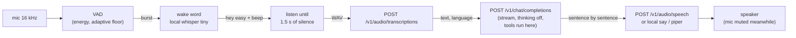

# easyai-assistant — voice assistant

An always-listening voice assistant that runs on a machine with a
microphone and a speaker, on Linux (ALSA) and macOS (CoreAudio), with no
third-party libraries. Say **"hey easy"** or **"oi easy"**, ask, pause,
and it answers aloud with a male voice in the language you used
(Portuguese or English). Every network call is OpenAI-shaped, so the same
binary works against easyai-server, llama-server or OpenAI with an API
key. Normative text: `spec.md` → "easyai-assistant".



## 1. Run it

```bash
# on the server box (installer writes /etc/easyai/easyai.ini [ASSISTANT] and a unit)
sudo systemctl status easyai-assistant
journalctl -u easyai-assistant -f

# on a Mac against a box on the LAN
easyai-assistant --endpoint https://ai-pro.local:8080 --insecure-tls --api-key "$TOKEN"

# test the chat + voice path without a microphone
easyai-assistant --endpoint http://127.0.0.1:8080 --text "que horas são?"

# one question then exit (CI / smoke test)
easyai-assistant --once
```

Startup prints the audio backend, the voice source (server endpoint or
local engine), the wake model and the tools. `--verbose` adds the VAD
levels, every transcript the wake model heard, and timings.

## 2. What happens, step by step

1. **Listening.** The mic is read in 20 ms periods. An energy VAD with an
   adaptive noise floor marks speech. A burst (speech plus 300 ms of
   pre-roll, ended by 500 ms of silence, at most 4 s) goes to the local
   wake model (`ggml-tiny.bin`, ~0.3 s on CPU).
2. **Wake word.** The transcript is normalised (accents folded,
   punctuation dropped) and matched: one of `hey hi oi ei ok ola alo`
   before the name, the name within one spelling edit. "Hey easy, what
   time is it?" is answered right away; a bare "oi easy" beeps once and
   listens.
3. **Question.** Listening ends after `pause_ms` (1500) of silence or
   `max_listen_ms` (20 000). The audio goes as WAV to
   `/v1/audio/transcriptions` (`verbose_json`, so the language comes
   back). An empty transcript gives a double beep.
4. **Answer.** `/v1/chat/completions`, streaming, with the built-in system
   prompt (short, same language, no lists, no reasoning, announce tools)
   and `chat_template_kwargs.enable_thinking=false`. Tools run inside the
   assistant exactly like in `easyai-cli`: `datetime`, `web`, and any
   `EASYAI-*.tools` manifests under `external_tools`.
5. **Voice.** Each complete sentence is sent to `/v1/audio/speech` and
   played while the next one is still being generated. The microphone is
   muted until playback ends plus 300 ms.
6. **Memory.** The conversation keeps the last `history_turns` turns and
   restarts after `history_idle_s` seconds of silence.

## 3. Configuration — `[ASSISTANT]` in `easyai.ini`

Precedence: CLI flag > INI key > default. `--config` picks the file
(default `/etc/easyai/easyai.ini`).

| INI key | flag | default | meaning |
|---|---|---|---|
| `name` | `--name` | `easy` | wake name |
| `endpoint` | `--endpoint` | `http://127.0.0.1:8080` | OpenAI-compatible base URL |
| `api_key` | `--api-key` | | Bearer token (env `EASYAI_API_KEY` as fallback) |
| `model` | `--model` | `default` | model id in the request |
| `stt_endpoint`, `tts_endpoint` | `--stt-endpoint`, `--tts-endpoint` | = endpoint | other boxes for speech in / out |
| `language` | `--language` | `auto` | force `pt` / `en` transcription |
| `pause_ms`, `max_listen_ms` | same | 1500, 20000 | end of question |
| `wake_model` | `--wake-model` | `models/stt/ggml-tiny.bin` | local whisper; `server` = send every burst to the STT endpoint |
| `mic`, `speaker` | same | `default` | ALSA device names (`plughw:1,0`); macOS uses the system default |
| `tts` | `--tts` | `auto` | `server` / `say` / `piper` / `espeak`; auto = endpoint, else local |
| `voice_pt`, `voice_en`, `piper` | same | engine defaults | local voices |
| `tools` | `--tools` | `datetime,web` | built-in tools; empty = none |
| `external_tools` | `--external-tools` | | directory of `EASYAI-*.tools` |
| `system` | `--system` | built-in | file path or inline text |
| `history_turns`, `history_idle_s` | same | 6, 300 | conversation memory |
| `verbose`, `tls_insecure` | `--verbose`, `--insecure-tls` | off | |

Pointing it at OpenAI:

```ini
[ASSISTANT]
endpoint = https://api.openai.com
api_key  = sk-...
model    = gpt-4o-mini
tts      = auto        ; OpenAI's /v1/audio/speech answers, voices pt/en map to its defaults
```

## 4. Voices

The box's `/v1/audio/speech` (easyai-server, `[TTS]`) uses **Kokoro-82M**,
a natural neural voice, through the helper `easyai-tts-kokoro.service`
(`scripts/easyai_tts_kokoro.py` in a Python venv at `/opt/easyai/kokoro`):
`pm_alex` for Portuguese, `am_michael` for English, both male;
`--kokoro-voice-pt pm_santa` / `--kokoro-voice-en bm_george` at install,
or `[TTS]` → helper flags, pick others. **piper** (`pt_BR-faber`,
`en_US-ryan`) stays installed as the server's automatic fallback when the
helper is down. On a Mac without a server voice the assistant falls back
to `say` (Eddy pt-BR, Daniel en-GB); `espeak-ng` is the last resort.

Running the Kokoro helper by hand (Python ≥ 3.10, system `espeak-ng`
for pt-BR):

```bash
python3 -m venv venv && ./venv/bin/pip install kokoro-onnx
curl -LO https://github.com/thewh1teagle/kokoro-onnx/releases/download/model-files-v1.0/kokoro-v1.0.onnx
curl -LO https://github.com/thewh1teagle/kokoro-onnx/releases/download/model-files-v1.0/voices-v1.0.bin
./venv/bin/python scripts/easyai_tts_kokoro.py --model kokoro-v1.0.onnx --voices voices-v1.0.bin --port 8111
easyai-server ... --tts-url http://127.0.0.1:8111     # or [TTS] url =
```

## 5. Limits

No barge-in while it speaks, no speaker identification, energy VAD (a
loud TV costs a tiny-whisper run per burst), languages other than pt/en
are answered in the `en` voice.
