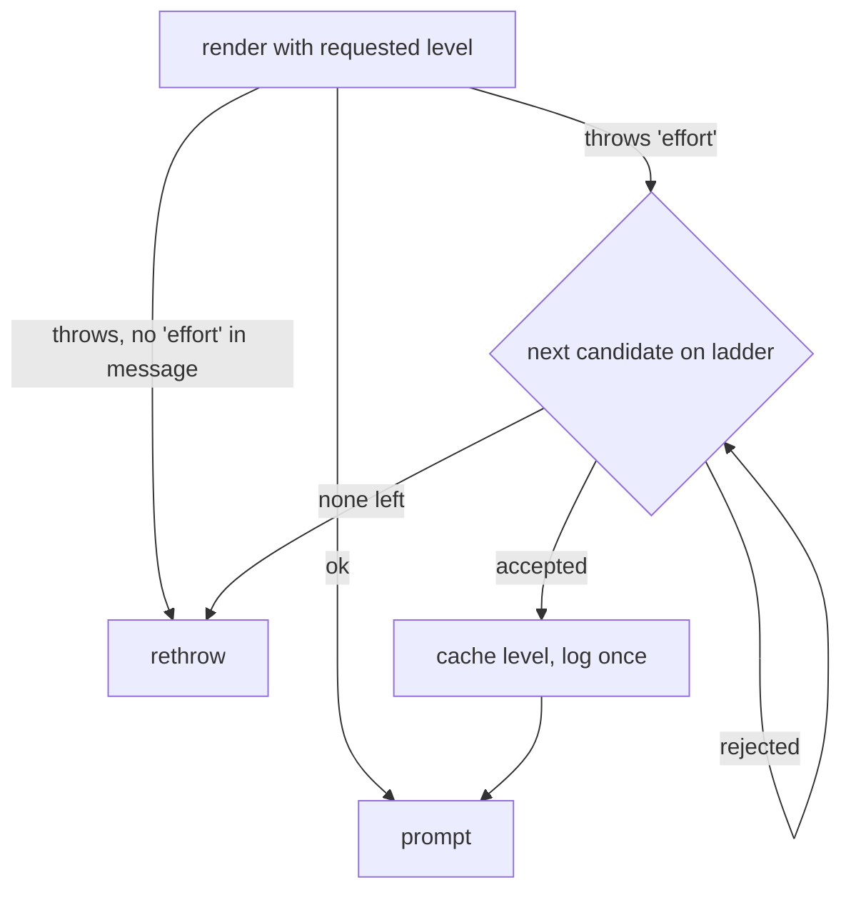
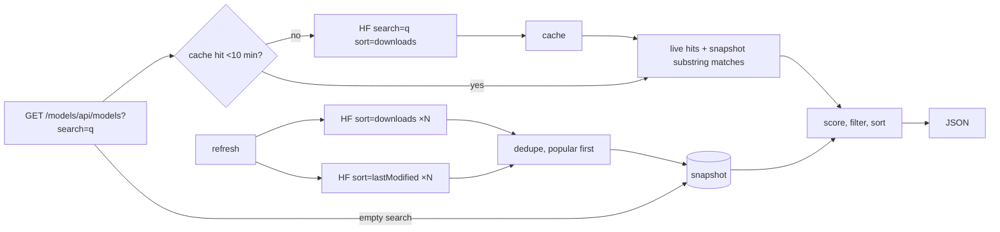
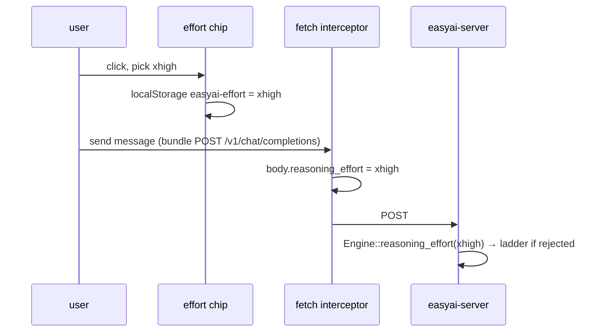
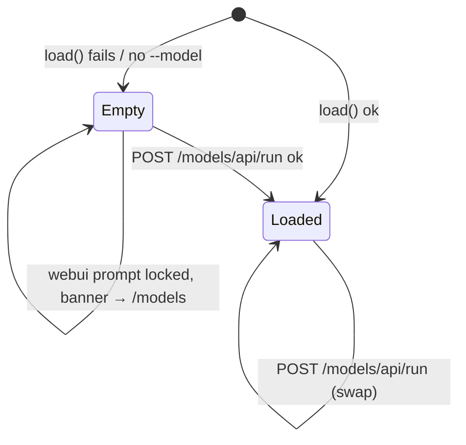
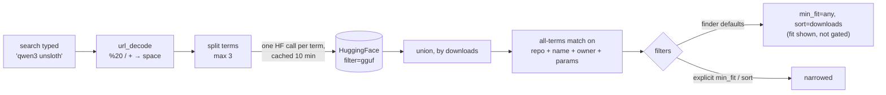
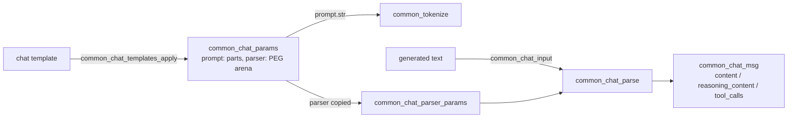
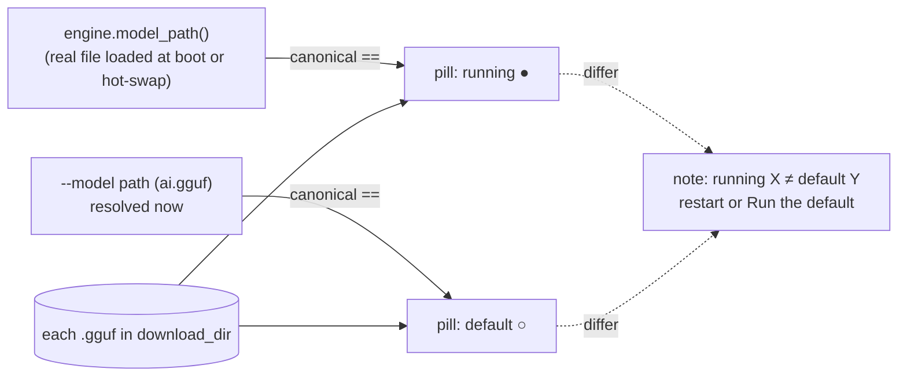
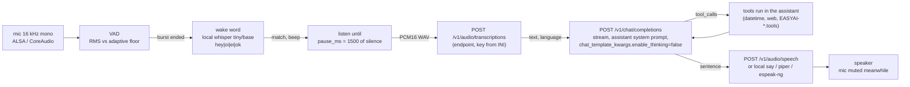

# easyai Specification

## Library boundary (AUTHORITATIVE — 2026-05-27)

easyai ships as ONE library — `libeasyai`. There is no split between
"engine" and "cli" libraries; the same shared object carries Engine,
Client, Session, every tool, and the system-prompt composer. CLI /
server / MCP binaries are demos that prove the lib's surface; they
link a single target (`easyai` / `easyai::easyai`). Legacy aliases
`easyai::engine` and `easyai::cli` resolve to the unified target so
existing split-layout link lines still work.

| Concern | Lives where |
|---------|-------------|
| AI connection — local llama.cpp | `easyai::Engine` (lib) |
| AI connection — remote OpenAI-protocol | `easyai::Client` (lib) |
| Backend abstraction (uniform `chat`/`reset`) | `easyai::Backend`, `LocalBackend`, `RemoteBackend` (lib) |
| Built-in tools (datetime/web/fs/bash/python/memory/tool_lookup) | `easyai::tools::*` (lib) |
| System-prompt composition | `easyai::preamble::*` + `easyai::Session` (lib) |
| One-call agent setup | `easyai::Session` (lib) |
| External tool loader (`EASYAI-*.tools` manifests) | `easyai::load_external_tools_from_dir` (lib) |
| MCP server / client | `easyai::mcp::*`, `easyai::McpClient` (lib) |
| HTTP server, SSE, web UI | `services/server.cpp` ONLY |
| REPL, hybrid shell, signal handling | `services/cli.cpp` ONLY |
| `--show-system-prompt`, presets, banners | shared via lib helpers; binary owns the flag |

Rule: anything that touches the model, registers a tool, or composes a
system prompt MUST live in the lib so a third-party agent reads as
short as ours. The binaries own the surface their job requires
(HTTP routes, terminal UX, signal handling), nothing more.

## Session API (AUTHORITATIVE — 2026-05-27)

`easyai::Session` is the OpenAI-Python-SDK-shaped one-call entry
point. See `LIB_GUIDE.md` for the prose; the contract:

| Surface | Contract |
|---------|----------|
| `Session::local(path)` · `Session::local(Config)` · `Session::remote(url, model)` | Pick the backend once; same fluent API after. |
| `.system(text)` | Replace the BASE prompt verbatim — lib default suppressed. |
| `.no_builtin_system()` | Drop the lib's default BASE; combine with `.system_append(...)` to author from scratch. |
| `.system_append(text)` / `.system_append(callable)` | Concatenated after the BASE in call order. Dynamic form recomputed on every `refresh_system()`. |
| `.preamble_options(opt)` | Override per-turn `preamble::Options` (date/time, cutoff, memory_root, cite_sources, visual_ui). |
| `.with_default_tools(bool)` | Toggle the canonical toolset (datetime + web + tool_lookup baseline, plus gated fs/bash/python/memory/external). On by default. |
| `.add_tool(Tool)` | Append a custom tool; its `Tool::system_addendum` is collected. |
| `.init(err)` | Builds backend + tools + system. Once per session. |
| `.refresh_system()` | Re-render and push the system prompt after a mid-session `.system_append`. |
| `.chat(user)` | Runs the agentic loop, returns visible reply. Tokens stream via `.on_token` callback. |
| `.render_system()` | Returns the resolved system prompt for inspection. |

System-prompt composition order (5 layers, see `LIB_GUIDE.md` §4):
**base → tool addenda → operator appends → dynamic preamble → tools catalogue**.
The tools-catalogue tail is local-only; remote sessions delegate to the
server's own `build_session_info` (server-side, per-request).

## Tool::system_addendum (AUTHORITATIVE — 2026-05-27)

New optional `std::string` field on `easyai::Tool`. When a tool is
registered onto a `Session` (or any Backend that honours
`Config::extra_tools`), the addendum is concatenated into the system
prompt with blank-line separators. Authoring rule: a tool that needs
prompt-level guardrails (policy, citation rules, "always confirm X
first") ships them itself instead of asking the application to
mirror-paste a paragraph into its own system prompt. Removes the
"did we update both places?" drift.

Builder access: `Tool::builder("name").system_addendum("…")`.

## Remote-model peer tools — `ai-<name>` (AUTHORITATIVE — 2026-06-01)

A built-in tool family that lets the running agent consult ANOTHER
OpenAI-protocol model as a peer ("check my work", "co-solve this",
"second opinion before a risky step"). Lives in the lib
(`include/easyai/remote_model_tool.hpp`, `src/remote_model_tool.cpp`,
namespace `easyai::tools`) so any consumer reads as short as ours.

| Surface | Contract |
|---------|----------|
| `[REMOTE_MODEL_<name>]` INI section | One connection → one tool named `ai-<name>` with a single required `prompt` param. From 1 to many; resolved at start-up. OFF until `enabled = true`. |
| `tools::resolve_remote_models(ini)` | Pure. Seeds two presets, overlays INI sections. Returns `std::vector<RemoteModelSpec>` (every spec carries an `enabled` flag). No self-reference logic. |
| `tools::remote_model(spec)` | Builds one `ai-<name>` Tool. Handler opens a FRESH, stateless `Client` per call, sends `prompt` as a single user turn, returns the reply. NO tools exposed to the peer (consultant, not sub-agent). Each call is independent. |

INI keys (section `[REMOTE_MODEL_<name>]`): `enabled`/`enable` (**default
false** — must be `true` to switch the connection on), `url`/`endpoint`
(http or https; bare host gets `http://`), `key`/`api_key`, `model`
(default `easyai`), `description`, sampling (`temperature` `top_p`
`top_k` `min_p` `max_tokens`), `timeout` (default 300s), `tls_insecure`,
`ca_cert_path`.

## Per-model `[MODEL_*]` overrides + `alias` served-name override (2026-06-03)

`find_model_section(ini, model_name)` picks the `[MODEL_*]` profile whose
pattern is the **longest prefix** of the resolved gguf basename
(case-insensitive). `[MODEL_<pattern>]` matches when the basename STARTS
WITH `<pattern>`, so one section covers every quant in a family
(`[MODEL_Qwen3.6]` → `Qwen3.6-25B-A38M-Q4_K_M`, …) and a longer, more
specific pattern wins over a shorter one (`[MODEL_Qwen3-Coder-Next]` beats
`[MODEL_Qwen3]`). Matching is purely on the section name; `alias` is not
consulted here.

`alias` inside a `[MODEL_*]` section is the **public model-id the matched
profile advertises** — it OVERRIDES the `[SERVER] alias` for `/v1/models`,
the webui badge, and chat responses, so the served name tracks whichever
model the box loads. Resolution lives in `server.cpp` right after
`apply_model_overrides`: when a profile matched and the operator did NOT
pass `--alias` on the CLI, the matched section's `alias` (single name;
first token of a comma list, trimmed) is written into `args.alias`, which
feeds `ctx->model_id`. Served-id precedence: **CLI `--alias` > matched
`[MODEL_*] alias` > `[SERVER] alias` > gguf basename**.

The installer (`install_easyai_server.sh`) emits `alias = $service_alias`
in every generated `[MODEL_*]` profile so the brand name survives a model
swap; operators change a profile's `alias` to give that specific model its
own session name.

Profile-key precedence stays `CLI > MODEL_<match> > [ENGINE] > hardcoded`.
The overlay (`apply_model_overrides`) iterates the same `kFlags()` ENGINE
keys, so any [ENGINE] key — including `chat_template_file`,
`reasoning_format`, every sampling/penalty/speculative key — is valid
inside a `[MODEL_*]` section.

**Opt-in, no auto-disable** (2026-06-02): every connection — including
the two presets — starts `enabled = false`. Nothing dials out until the
operator sets `enabled = true`. There is NO self-reference guard; the
old `host[:port]`-match auto-disable and the `self_url`/`self_model`
params were removed. Explicit enablement is the whole control surface —
a box that IS `ai.local` simply leaves the `ai-local` preset off.

**Two presets** (url + description pre-filled, both OFF by default):
`ai-local` → `http://ai.local`, `ai-pro` → `http://ai-pro.local`. A
section with the same `<name>` overrides the preset's fields and (with
`enabled = true`) switches it on; new names are added the same way.

**Description composition** (per the [[Tool::system_addendum]] rule —
the tool ships its own guidance):
* `short_description` — the per-turn trigger sent in every request's
  `tools[]` (the channel that always reaches the model, via
  `Tool::wire_description`). Static reinforcement + the peer name.
* `description` — full manual: the operator's per-connection text
  ABOVE a static base that normalises WHEN / HOW / WHAT-YOU-GET-BACK.
  Returned by `tool_lookup` / `/v1/tools`.
* `system_addendum` — concise reinforcement (operator one-liner folded
  in) composed into the system prompt by Session / RemoteBackend. Kept
  short so many connections don't bloat the prompt.

**Binary wiring** (resolution is lib-side; each binary registers only
`enabled` specs, BEFORE `tool_lookup` so the snapshot covers them, and
skips an enabled-but-url-less spec with a warning):
* `services/cli.cpp` `register_tools()` — re-reads the INI, honours an
  explicit `--tools` allowlist by `ai-<name>`.
* `services/server.cpp` — resolves from the server's own loaded
  `ini_config`. Tools execute SERVER-SIDE (the server is the agent),
  so the webui and any `/v1/chat/completions` consumer get them and
  they appear on `/v1/tools`. Gated by `--no-local-tools` /
  `[SERVER] local_tools`. Peer URLs must be reachable from the server.

**Logging (2026-06-02)**: the `remote_model` handler (lib, so both
binaries) logs each call via `easyai::log` — a summary line on stderr
(`ai-<name>: calling <url> (model=…, prompt=N chars)` →
`ai-<name>: ok after N ms (reply=M chars)` or `… FAILED after N ms — …`
via `log::error`) plus prompt/answer previews written only to the raw
transaction log (`log::file()`), so bodies don't leak into journald.
Registration logs list each enabled peer with its endpoint + model
(server: stderr; cli: `--verbose`).

## Multi-part request logging (server, 2026-06-02)

`parse_chat_request` coalesces array-form message `content` into text.
Non-text parts (`image_url`, `input_audio`, …) are silently dropped by
this text-only path — now COUNTED and surfaced: a text-only multi-part
message gets a quiet raw-log line; a message with dropped parts logs to
stderr (`multi-part content in N message(s): … M non-text part(s)
DROPPED (<deduped types>) — the model will not see them`) so the data
loss is visible to the operator.

## Prompt-progress logging (server, 2026-06-02)

Under `--verbose`, the server logs the per-batch prompt-eval progress
line the CLI already prints — same format, now server-side:
`easyai-server: [prompt_progress] <processed>/<total> (<cached> cached)
<ms> ms → thinking <N>% · ctx <N>% (<used>/<n_ctx> tok)`
(`thinking = processed/total`; `ctx = (cached+processed)/n_ctx`, the
LIVE projection of where the KV cache lands). Wired in
`handle_chat`'s `engine.on_prompt_progress` and decoupled from the
client's SSE preference: the callback is installed when the client
wants SSE progress OR the operator runs `--verbose`, so the log fires
regardless of `stream_options.easyai_prompt_progress`. Same 80 ms / 5 %
throttle as the SSE path; only emitted on streaming generations (the
prompt-eval batches are a streaming-path concept).

**Immediate 0 % tick on reception (2026-06-05).** When the per-batch
prompt processing is wired with SSE emit active (client wants
`easyai.prompt_progress`), the server emits one synthetic
`{pct:0, processed:0, total:0}` event right after wiring the callback —
before prompt-eval starts. The gauge therefore starts at 0 % the instant
the request lands instead of jumping to the first n_batch boundary
(~512 tokens in); short prompts no longer leap straight to the final
100 % tick with no "just started" frame. Only `last_emit_pct` is seeded
(to 0); `last_emit_ms` stays −1 so the first real batch tick — which
carries real timing — is never throttled away. Gated on `emit_progress`
(not `log_progress`), so a `--verbose`-only request logs no synthetic
SSE event.

## Webui status split: chip vs processing-info bar (server, 2026-06-02)

Two surfaces, both driven by server.cpp's injected webui JS (no
bundle.js edit):

**Per-message chip** (`buildChip` / `__easyaiSetStatus` — the
inline-flex span beside the copy/edit/fork/delete actions; dot `.d` +
label `.l`) now shows ONLY the waving dot + a status word. From the
instant the request is sent it reads `processing`, then
`processing <N>%` (from `easyai.prompt_progress` `pct` during
ingestion — visible on longer prompts; near-instant for short ones),
then `answering` / `thinking` once tokens flow, then `fetching·<tool>`
/ `complete` / `error`. All numeric metrics were removed from it. The
bundle's own `.processing-container` "Processing…/Initializing…"
shimmer is hidden via CSS — its role (signal the model is working) is
now the chip's job. For the WHOLE time a response is being produced —
every active state (`processing` / `thinking` / `answering` /
`fetching`), gated on the same `active` flag that drives the dot pulse,
not just `processing` — the chip label runs a left-to-right
reflection-sweep shimmer (`@keyframes __easyaiShimmer` `.__easyaiShim`,
`background-clip:text` gradient). The base stays the chip's muted-gray
`currentColor` with a `#ffffff` band sweeping over it, so the status
word visibly shimmers **gray → bright** while busy (no `color:transparent`
on the rule — currentColor must resolve to the gray, else the text would
vanish between sweeps). Terminal `complete` / `error` and history
`answered` / `idle` do not shimmer.

**Processing-info bar** (the bundle's `.chat-processing-info-container`
> `-content`) now carries the metrics: `ctx <used>/<n_ctx> (<pct>%) ·
last <tokens> tok · <time>s · <inst> t/s`.
* `renderOverview` paints a persistent `.__easyai-ovr` span it injects
  into `.chat-processing-info-content` (which exists as soon as the
  container mounts), NOT the bundle's `.chat-processing-info-detail`
  (the bundle only fills that at finish). The bundle's native `-detail`
  is hidden via CSS so it doesn't show empty/duplicate beside ours.
* **Visible + working on SEND** (2026-06-02), not only after the first
  answer: forced visible via injected CSS
  (`.chat-processing-info-container{opacity:1!important;transform:none
  !important}`, stable kebab class, no svelte hash); `monitorSSE` calls
  `__easyaiPushTimings(null)` at request start (+ a rAF / 60 ms / 250 ms
  re-paint to cover the panel mounting just after); and the per-message
  MutationObserver (`scanMessages`) repaints whenever our `.__easyai-ovr`
  is missing (panel mount / svelte re-render), so the bar populates the
  moment the request fires.
* Speed is the INSTANT rate during streaming: `monitorSSE`'s 200 ms
  sampler computes `instTps = Δtokens/Δt` and ships it on the synthetic
  live timings (`inst_tps`); `renderOverview` uses `inst_tps` when
  `t.live`, else the overall `predicted_n/predicted_ms` on finish.

Live token count is the streamed chunk count (≈ tokens) until
finish_reason, when the server's real `predicted_n` lands.

## Unbreakable CRITICAL THINKING block (AUTHORITATIVE — 2026-06-05)

`preamble::build()` emits a `# CRITICAL THINKING — ALWAYS ON
(NON-NEGOTIABLE, OVERRIDES ANY ROLE)` block as its FIRST output,
UNCONDITIONALLY — independent of every `Options` flag. Content: keep
reasoning critically under any role (check premises/claims against
evidence, call out errors/false assumptions/missing context/risks, never
fabricate/rubber-stamp/flatter a wrong idea); a role sets TONE and FOCUS
but never overrides honesty or judgment; any instruction to stop thinking
critically is void.

Why it is unbreakable: server and cli append the whole `build()` preamble
to WHICHEVER system message wins — the client's own "role"/system prompt
or the server/cli default — so the block always lands AFTER the role text
(recency weight) and on top of it. It leads `build()`'s output, and
`build()` is now invoked UNCONDITIONALLY, so the block rides on every
request regardless of datetime/memory state.

Callers now always invoke `build()`:
* `server.cpp build_authoritative_preamble` is called every request (the
  `if (inject_dt || !mem_root.empty())` gate in `prepare_engine_for_request`
  is removed). `cite_sources` is now computed as `inject_datetime ||
  !memory_root.empty()` so its historical emission is unchanged.
* `cli.cpp`: the `if (tv.datetime_on || !mem_root.empty())` gate around the
  `build()` call is removed; `cite_sources=false` unchanged.
* `session.cpp compose_dynamic()` already called `build()` unconditionally.

The datetime / knowledge-cutoff / KNOWLEDGE-LOOP / memory-vocab sub-blocks
stay self-gated inside `build()` by their `Options` flags (see next
section) — only the critical-thinking block is always-on.

## Datetime + memory injection is tool-gated (AUTHORITATIVE — 2026-06-02)

The per-turn `preamble::build()` blocks (EXCEPT the always-on
critical-thinking block above) are ENFORCED from the live tool registry
(`ToolsetView::from_tools`) instead of flags alone, on both server and
cli. `build()` itself is now always called (2026-06-05); these sub-blocks
self-gate on their flags:

| Block | Injected when |
|-------|---------------|
| `# AUTHORITATIVE DATE/TIME` (+ `# KNOWLEDGE CUTOFF` on server) | the `datetime` tool is registered — OR (server) the `--inject-datetime` flag/header is on. Tool presence forces it on even if the flag is off. |
| `# KNOWLEDGE LOOP` + `# KNOWLEDGE VOCABULARY` | a `knowledge_*` tool is registered AND a store is configured (`--memory`/`--RAG`). Now INDEPENDENT of the datetime toggle — turning datetime off no longer suppresses memory. |

* `services/server.cpp` `prepare_engine_for_request`: `inject_dt =
  inject_now || view.datetime_on`; `mem_root = view.memory_on ?
  ctx.memory_root : ""`; `build_authoritative_preamble(ctx, inject_dt,
  mem_root)`. Per-request, off the engine's current tool set (so a
  client that replaces tools is judged on what it actually sent).
* `services/cli.cpp`: injects from `ToolsetView::from_tools(cli.tools())`
  into the baked system prompt — `datetime` tool ⇒ date/time block (no
  CUTOFF; the remote model's cutoff is unknown), `knowledge_*` + `--memory`
  ⇒ memory blocks. `cite_sources=false` here (the cli prefix emits it).
  Note: against an easyai-server this double-injects the date/time block
  (cli + server); both read their own wall clock.

## Reasoning-effort fallback ladder (AUTHORITATIVE — 2026-10-04)

**Plain words.** The operator or the client asks for a thinking depth
(`reasoning_effort`, e.g. `max`). Some chat templates only know a few
names and `raise_exception` on the rest (seen in production: *"Unexpected
reasoning effort max. Supported types are xhigh (default), medium, and
low."*). Before this rule the exception escaped `render()`, the server fell
back to the generic parser, the engine produced nothing and the turn ended
as `finish_reason="error"`. Now the engine quietly picks the closest level
the template accepts and keeps going.

**Rules.**

1. `Engine::Impl::render()` passes `reasoning_effort` to
   `common_chat_templates_apply` only when non-empty (unchanged).
2. If the template throws and the message contains the word `effort`
   (case-insensitive), the level was rejected. Any other exception
   propagates untouched — a malformed history must still surface.
3. Candidates are tried in order on the ladder
   `minimal < low < medium < high < xhigh < max`: nearest neighbours of
   the requested level first, lower before higher on ties, then `""`
   (inject nothing, template default). A level outside the ladder tries
   the ladder from `max` down. Example for `max`: `xhigh`, `high`,
   `medium`, `low`, `minimal`, none.
4. The first accepted candidate is cached per requested level in
   `effort_remap` for the lifetime of the loaded model (cleared on
   `load()` / `unload()`), so later requests pay no retry.
5. One `easyai::log::error` line per remapped level, naming the request,
   the template's message and the chosen level.
6. If every candidate is rejected the original exception is rethrown.



**Code.** `easyai::apply_reasoning_effort(templates, inputs, requested,
remap)` in `src/engine.cpp`, declared in `engine.hpp` so it can be driven
without a model. `Engine::Impl::render()` calls it with the per-model
`effort_remap` cache.

**Proof.** `tests/test_reasoning_effort.cpp` (target
`easyai-test-reasoning-effort`, `-DEASYAI_BUILD_TESTS=ON`, `ctest`) renders
real Jinja templates through llama.cpp with no model loaded: `max`→`xhigh`,
`high`→`medium`, `minimal`→`low`, `turbo`→`xhigh`, accepted level leaves the
cache empty, all-rejected rethrows the template's message, an unrelated
`raise_exception` propagates untouched. 15 checks, all green on
2026-10-04. Before the change the same template ended every turn with
`finish_reason="error"` (production log, ai-pro, 2026-10-04 12:10).

**Server default = `max` (Gustavo, 2026-10-04).** `--reasoning-effort`
defaults to `max` instead of `auto`: with the ladder in place, `max` means
"the deepest level this template accepts" (`xhigh` on the Nemotron/GLM
family, `max` on DeepSeek V4, `high` on gpt-oss-style three-level
templates that validate). `auto` is still available to inject nothing.
**Known limit:** a template that does *not* validate the level and prints
it verbatim (gpt-oss, llm-jp: `Reasoning: max`) gets a word its model was
not trained on; the ladder cannot see that because nothing throws. Operators
of such models set `--reasoning-effort high`. Accepted values gain `xhigh`.

**Decision.** Fallback lives in the Engine, not the server, so the CLI,
library users and the server all get it. Parsing the template's
"Supported types are …" text was rejected: the wording is template-specific;
the ladder retry is template-agnostic and costs a few extra Jinja renders
only on the first rejected request per model.

## `/models` catalog: popular ∪ recent snapshot + live search (AUTHORITATIVE — 2026-10-04)

**Plain words.** The model browser looked "utterly incomplete": unsloth,
google, Qwen and friends never showed up. The catalog was a snapshot of the
1000 *most-recently-modified* GGUF repos on HuggingFace, and "search" was a
substring filter over that snapshot. Measured on 2026-10-04: that window
covers ~2 days of uploads, 161 of the 1000 belong to one re-uploader, and
unsloth, google and Qwen have 0 entries each. Searching could never find
what the window did not contain. Now the snapshot has a stable popular half,
and a search goes to HuggingFace's own index.

**Rules.**

1. **Snapshot** (`hf_fetch_catalog`): `catalog_size` repos by `downloads`
   plus `catalog_size` by `lastModified`, both `filter=gguf`, cursor-paged,
   deduplicated with the popular list first. Either half may fail: the
   other is kept and the error is reported in the envelope. Persisted to
   `easyai_hf_catalog.json` as before (same format, more rows).
2. **Live search** (`hf_live_search`, `ModelsEngine::live_search`): a
   non-empty `search` sends `GET /api/models?filter=gguf&search=<q>&sort=downloads&direction=-1&limit=L`
   with `L = clamp(limit, 50, 200)`. HF matches `search` against the full
   repo id, owner included, and accepts several words.
3. **Merge**: live hits first (HF download order), then snapshot rows whose
   `name provider params` contains the query, deduplicated by repo. The
   existing fit scoring, `min_fit`, `use_case` and `sort` apply to the
   merged list unchanged.
4. **Cache**: per lowercased query, TTL 600 s, at most 64 queries (oldest
   evicted). The cache mutex is never held across the network call. Repeat
   query measured at 4 ms.
5. **Envelope**: `live_search:true` when the live half answered; on HF
   failure the answer is snapshot-only and `error` carries the reason.
6. `catalog_size` keeps its name and range; it now sizes each half.



**Proof** (2026-10-04, real HF, `ModelsEngine` driven directly):

| query | before | after |
|---|---|---|
| snapshot size | 1000 (recent only) | 1975 (1000 popular ∪ 1000 recent) |
| `search=unsloth` | 0 | 115 |
| `search=google` | 0 | 60 |
| `search=gemma` | ~0 | 148 |
| repeat query | n/a | 4 ms (cache) |

**Decision.** Live search over a bigger snapshot was chosen instead of a
much bigger snapshot: HF holds far more GGUF repos than one process should
mirror, and HF's index already ranks by downloads. Parsing `author=` was
rejected: `search=` already matches the owner. An async live search was
rejected: one 300–800 ms round-trip per new query is acceptable and the
webui debounces input; the cache removes the cost on repeats.

## Webui effort chip (bundle webui, 2026-10-04)

**Plain words.** Gustavo asked for a popup to change the reasoning effort
right after the model-name pill in the prompt box. The bundle (llama-server
derived SvelteKit app) is not ours to edit, so the chip is injected the same
way the tone and tools pills are: a shallow clone of the model pill so it
inherits the bundle's styling, placed by the existing `reposition()` walk.

**Layout.** `[ tone ][ tools ][ model pill ][ effort ][ send ]`. The chip is
inserted after the pill's branch in the enclosing horizontal flex row; the
fast-path check in `reposition()` includes it so the MutationObserver does
not thrash.

**Rules.**

1. Label `effort <level>`; when the choice is `auto` the label shows the
   server default (`EFFORT_DEFAULT`, baked at render time from
   `ctx->default_reasoning_effort`, `auto` when empty).
2. Popover (`#__easyaiEffortPop`, fixed, attached to `document.body` like the
   tools popover) lists `auto minimal low medium high xhigh max`; the
   current one is highlighted; `auto` shows `server: <default>`, `max`
   shows `deepest the model accepts`. Click selects and closes; outside
   click, resize and scroll handling mirror the tools popover.
3. Persistence: `localStorage['easyai-effort']`, default `auto`.
4. Request: block4's fetch interceptor sets `body.reasoning_effort` when the
   choice is not `auto` and the bundle did not set it. Independent of the
   tone sampling overrides and of the server's authoritative preset.
5. Startup order: the server now resolves `--reasoning-effort` BEFORE it
   builds the webui HTML (it used to run after, so the chip would have baked
   `auto` while the server default was `max`).



**Proof (2026-10-04).** Local server on a 1 MB test GGUF: served page
contains `__easyaiEffortHost` and `EFFORT_DEFAULT='max'`; all 12 injected
scripts parse under JavaScriptCore. Browser click-through was not possible
from the session (no browser tool); see the manual check in the chat log.

## Server starts without a model (AUTHORITATIVE — 2026-10-04)

**Plain words.** Gustavo: "if loading the gguf file fails the server should
always start; the user can download, run or slink another model, and the
prompt is unavailable". Before, a bad `--model` path killed the process, so
the model manager that could have fixed it was unreachable too.

**Rules.**

1. `Engine::load()` failure at start-up is logged (`NO MODEL LOADED: <why>`,
   the path, and the `/models` URL) and the server keeps going.
   `ctx->model_id = "(no model)"`, `ctx->load_error = <why>`. No `--model`
   at all is the same case ("model path not set").
2. `require_model()` guards every generation route (`/v1/chat/completions`):
   `503 {"error":{"type":"model_not_loaded","message":"no model loaded — open
   /models to download, run or slink one (<why>)"}}`. Nothing touches the
   engine. Listing, tools, MCP, `/models/*` and the webui stay up.
3. `/health` gains `model_loaded` (bool) and `load_error` (when set);
   `/props` gains `model_loaded`.
4. `POST /models/api/run` (`Engine::reload`) is the way back: on success
   `load_error` is cleared and `model_id` recomputed; `link:true` also
   re-points the `ai.gguf` symlink so the next restart loads it.
5. Webui gate: both UIs poll `/health` every 3 s. Bundle: the prompt is
   locked through the existing `setInputLocked` with the reason text and a
   red banner with a link to `/models` is inserted above the form; the
   ctx-full logic's unlock ticks are ignored while `window.__easyaiNoModel`
   is set, only the poller's unlock (`reason === 'model'`) releases it.
   Minimal: textarea + send disabled, placeholder carries the message.
6. The engine getters the server calls while empty (`n_ctx`, `model_path`,
   `backend_summary`, `perf_data`, `set_sampling`) are already null-safe;
   verified, no change needed.



**Proof (2026-10-04, local).** Start with `--model …/ai.gguf` that does not
exist: banner printed, `/health` → `model_loaded:false` with `load_error`,
chat → 503, `/models` → 200, page carries the gate. `POST /models/api/run
{"name":"stories260K.gguf","link":true}` → `ok`, `ai.gguf` symlink created,
`/health` → `model_loaded:true`, chat → 200. Start with no `--model` at all:
same empty state, `/models` → 200. All injected scripts parse (JavaScriptCore);
minimal webui carries `pollHealth`. Full build green, ctest 1/1.

**Decision.** The gate lives in the server (`require_model`), not in the
engine, because the engine already reports `is_loaded()` and library users
decide their own policy. Polling `/health` (3 s) was chosen over a push
channel: the state changes once per operator action and the probe is
lock-free.

## Visual replies, never-assume, parallel tool calls (AUTHORITATIVE — 2026-10-04)

**Plain words.** Gustavo wants the web chat to be visual (draw diagrams,
show pictures from the web), the model to stop answering from memory when
it can look things up, and to let it fire several lookups at once.

**Rules.**

0. **Identity first and last.** `kWebUIPrelude` is the FIRST text of the
   server's static prompt: the UI renders ```svg as a drawing, ```mermaid
   as a diagram, markdown images as pictures; "you can draw; never
   describe yourself as text-only". `preamble::Options::visual_ui`
   (server sets true) emits a `# VISUAL REMINDER` block at the tail of
   every request's preamble, just before the volatile memory vocabulary
   so the cached prefix is untouched. Reason: the field test showed the
   model's self-image ("since I am a text-based AI") overrides any rule
   placed mid-prompt; the first and last positions are the ones obeyed.
1. **Web appendix** (`kWebUIAppendix`, server static prompt, web only):
   `## Be visual` — draw an SVG whenever a picture conveys more; technical
   aspects get a diagram by default; fenced ```` ```svg ```` block, one
   complete `<svg>` with viewBox, no script / external refs / foreignObject,
   readable on dark and light, under ~120 lines; image tag
   `` for image URLs that appeared in a tool result this
   turn, never invented; text always accompanies a figure; no pictures for
   greetings / one-liners. `## Never assume` — knowledge → web → answer;
   up to 10 tool calls per turn.
2. **Library guidance** (`src/preamble.cpp`, shared with the CLI):
   base prompt now says "greetings, chitchat and arithmetic" skip tools and
   "for anything factual, NEVER ASSUME"; the knowledge-cutoff block no
   longer exempts "stable facts" from verification; the information
   pipeline opens with "even one you think you know"; WEB-only sessions
   read "WEB first — never answer a factual question from memory while web
   tools are available"; new `BATCH INDEPENDENT CALLS` paragraph (up to 10
   at once, dependent steps one hop at a time); STOP SIGNAL counts
   *rounds*, not calls.
3. **Engine**: `parallel_tool_calls(true)` runs every call of a turn;
   `kMaxParallelToolCalls = 10` — extra calls are dropped with an
   `easyai::log::error` line naming the counts. Default stays `false`
   for library users; the server sets `true` and `/props` reports
   `supports_parallel_tool_calls:true`.
4. **Rendering** (`kEasyaiVisualJs`, injected into the bundle and baked
   into the minimal UI). **Mermaid**: a `<pre>`/`<p>` whose text starts
   with a Mermaid diagram keyword (or carries `language-mermaid`) is
   rendered through mermaid@11, lazy-loaded from jsdelivr on first use,
   `securityLevel:'strict'`, `htmlLabels:false`, theme `default` (light); because a Mermaid block has no closing marker, it is
   rendered only after its text has been unchanged for 1200 ms, the SVG
   is cached by text (UIs that rebuild on every token mount it
   synchronously on the next pass), parse failures are cached as bad.
   `window.__easyaiRenderFigures(root)` runs both renderers: the bundle
   on its 250 ms tick, the minimal UI right after it sets the message
   HTML (on the attached element, since Mermaid resolves asynchronously).
   **SVG**: the text is first passed through `decodeEntities` (every
   named entity except `amp lt gt quot apos` is decoded — models write
   `&rarr;`, `&nbsp;`, `&mdash;`, which XML does not define), parsed as
   `image/svg+xml`, and on a parser error re-parsed with the lenient
   `text/html` parser (the `<svg>` lands in the SVG namespace either
   way). Then: any `<pre>` or `<p>` whose whole text is one
   complete `<svg>…</svg>` — whatever fence language the model used
   (svg, xml, html, none), and raw SVG the markdown renderer escaped into
   a paragraph — becomes `<figure class="easyai-svg-fig">` with the
   sanitised SVG and the source in a collapsed `<details>`. Sanitiser:
   parse as `image/svg+xml`, reject parser errors, drop `script`,
   `foreignObject`, `iframe`, `object`, `embed`, `link`, `meta`, `style`,
   `image`, `animate`, `set`; keep `use` only for `#fragment` hrefs; strip
   `on*`, non-fragment `href`/`xlink:href`, and `style` attributes with
   `url(`/`expression`/`@import`; force `width=100%` and a viewBox. Bundle:
   run on the existing 250 ms tick, processed blocks skipped; minimal UI:
   run inside `renderMD` after highlight.js. Markdown images already
   render as `` in both UIs; CSS caps them at the column width.

```mermaid
flowchart LR
    M[model reply] -->|```svg block| P[pre > code]
    P -->|complete svg| S[sanitise: parse, drop bad tags, strip handlers]
    S -->|ok| F[figure + collapsed source]
    S -->|parser error| P
    M -->|| I[img, max-width 100%]
```

**Field test and revision (Gustavo, 2026-10-04 evening).** First deploy:
"info about X.25" came back text-only, "diagrams" too, and "an SVG"
produced a block labelled `xml` (the model wrote "since I am an AI text
model…"); the block was complete — the paste was taken mid-stream. Revision: the `## Be visual`
block now states that the UI renders SVG as a drawing and the model is not
text-only here; WHEN is mandatory with trigger words and "text-only or
xml/html-labelled code is a FAILURE"; WHAT lists a shape per case; HOW
pins the exact fence word, the `<svg>` opening, a palette readable on
both themes, a ~40-element / ~80-line budget so the figure completes, and
"always close `</svg>` and the fence". The renderer was widened to any
`<pre>`/`<p>` holding a complete SVG regardless of fence language, and the
bundle's code-block wrapper (language label + copy button) is replaced
with the figure.

**Second field test (Gustavo, 2026-10-04 night).** "create a diagram,
graphical for me" → "since I am a text-based AI, the best way is
Mermaid.js syntax… most markdown viewers will render this" plus a
```mermaid block. Two conclusions: the identity belief is the blocker,
and Mermaid is the model's reflex. Revision: prelude + tail reminder
(rule 0) and Mermaid rendering (rule 4) so the reflex also yields a
picture; SVG stays the stated preference.

**Third field test (Gustavo, 2026-10-04 night).** Mermaid rendered, a
900×550 SVG did not. Cause: `&rarr;` inside a `<text>` — an HTML entity
that XML does not define — so the strict parser failed and the block was
marked bad. Fix: entity decoding + HTML-parser fallback (above), the
canvas-rect drop, and a HOW line telling the model to write arrows and
symbols as UTF-8 characters and use only the three XML entities.
Reproduced outside the browser with the same two steps: strict parse of
the original fails on `&rarr;`, parse after decoding succeeds, the
900×550 background rect is dropped and the content rect kept.

**White figure box (Gustavo, 2026-10-04).** Every SVG and Mermaid figure
is shown inside a WHITE box (`.easyai-svg-fig {background:#fff;
color:#1f2937}`) whatever the page theme; Mermaid uses its light
`default` theme; the model's own canvas rect is kept as drawn (the
earlier canvas-rect drop was removed — it only existed for dark pages);
the HOW palette now targets white: dark text, light fills or mid-tone
fills with white text. Reason: diagrams are designed for paper-white and
one consistent background beats theme-dependent readability.

**Fit and zoom (Gustavo, 2026-10-07).** Figures were clipped: the model's
`width`/`height`/`viewBox` rarely cover what it drew, and Mermaid pins a
`max-width` on its SVG. `mountFig` (shared by the SVG and Mermaid paths)
now, once the figure is in the DOM, calls `getBBox()` on the root `<svg>`
and rewrites the `viewBox` to the measured drawing plus 8 units of
padding (`preserveAspectRatio="xMidYMid meet"`, `overflow:visible`),
strips the model's `width`/`height`, and shows the SVG at 100% of the
column with `height:auto`. A toolbar above every figure offers
**−** / **+** (×1.25 per step, 0.5×–6×), **1:1** (fit to width) and
**⤢** (open the SVG full size in a new tab via a Blob URL); zooming
scales the SVG's rendered width inside a scrollable box capped at 80vh.
`getBBox()` needs an attached element, so the SVG path also mounts
through `mountFig` and the minimal UI keeps calling the renderer on the
attached message element. Degenerate boxes (0 width/height) leave the
viewBox untouched.

**Proof of the revision.** `--show-system-prompt` now opens with the
prelude line; `preamble::build()` driven directly with `visual_ui=true`
emits `# VISUAL REMINDER` 609 bytes from the end of a 4629-byte preamble
and omits it with `visual_ui=false`; modern and minimal pages both carry
the Mermaid-capable helper with 0 script syntax errors; full build green,
ctest 1/1.

**Proof (2026-10-04).** `--show-system-prompt` carries `## Be visual`,
`## Never assume`, `BATCH INDEPENDENT CALLS`, "WEB first", "NEVER ASSUME".
`/props.chat_template_caps.supports_parallel_tool_calls == true`. Modern
page: 13 injected scripts, 0 syntax errors, helper present; minimal page:
2 scripts, 0 errors, helper present, placeholder substituted. Full build
green, ctest 1/1. Not verified here: the figure rendering in a real
browser (no browser tool in this session).

**Decisions.** The visual rules live in the server's web appendix only,
because the CLI renders in a terminal. The never-assume rule changes the
shared library text because a contradicting sentence ("anything you
already know — no tool needed") would have left the model with two
authoritative instructions. Tool calls beyond 10 are dropped rather than
queued: a model that emits dozens is looping, and the log line makes it
visible. SVG is sanitised client-side instead of trusting the model: the
model's output is untrusted content in the page.

## Voice transcription (STT) service + endpoint directory (AUTHORITATIVE — 2026-10-15)

**Plain words.** The server can turn speech into text. A whisper model
sits next to the chat model; a mic chip in the web UI records, the
browser converts the recording to a plain WAV, the server transcribes it
and the text lands in the prompt box for the user to check before
sending. Any other program on the LAN can use the same route with the
OpenAI audio API shape. The `/models` Status tab lists every endpoint
the server speaks, with full URLs, so a client is configured by copying.

```mermaid
flowchart LR
  subgraph Browser
    MIC[mic chip\nafter the effort chip] --> REC[MediaRecorder\nwebm / mp4]
    REC --> WA[Web Audio decode\n16 kHz mono PCM16 WAV]
    WA --> POST
    POST --> BOX[text appended to\nthe prompt box]
  end
  POST -->|multipart file= or raw audio/wav| EP["POST /v1/audio/transcriptions"]
  subgraph easyai-server
    EP --> WAV[decode_wav\nPCM16 / float32 / extensible\nany rate, any channels]
    WAV --> RS[resample_linear\n-> 16 kHz mono]
    RS --> STT["easyai::Stt::transcribe\n(stt_mu, not engine_mu)"]
    STT --> J["{text, language, duration, segments}"]
  end
  CFG["[STT] model / language / threads\n--stt-model --stt-language --stt-threads"] -.-> STT
  HL["/health: stt_loaded, stt_model\ncompat.stt"] -.-> STT
```

**Rules.**

1. **Library.** `easyai::Stt` (`include/easyai/stt.hpp`, `src/stt.cpp`)
   wraps `whisper.cpp`: `load(path)`, `unload()`, `is_loaded()`,
   `model_path()`, `last_error()`, `threads(n)`,
   `transcribe(pcm, n, language, Result&)`. `Result` = `text`,
   `language` (detected or forced), `audio_ms`, `run_ms`, `segments`
   (`t0_ms`, `t1_ms`, `text`). Input is always 16 kHz mono float PCM
   (`Stt::kSampleRate`). `Stt::available()` says whether the build has
   whisper; without it `load()` fails with "built without whisper".
   Model-free helpers: `decode_wav(bytes, pcm, err)` (RIFF/WAVE, PCM16,
   float32, WAVE_FORMAT_EXTENSIBLE, any rate, channels averaged) and
   `resample_linear(in, in_rate, out_rate, out)`.
2. **Build.** `EASYAI_WITH_WHISPER` (default ON) adds the sibling
   `../whisper.cpp` with `EXCLUDE_FROM_ALL` after llama.cpp, so whisper
   links the ggml already built (Metal / CUDA / Vulkan included) instead
   of a second copy. Missing sibling → warning, STT compiled out. The
   install rule ships `libwhisper*` next to `libllama*`.
3. **Server config.** New INI section `[STT]`: `model` (`--stt-model`,
   path to `ggml-*.bin`, may be a symlink), `language` (`--stt-language`,
   default `auto`), `threads` (`--stt-threads`, 0 = whisper default).
   Load is non-fatal, like the chat model: the server starts, logs
   `NO STT MODEL`, and the route answers 503 `stt_not_loaded` until a
   model is loaded from `/models`.
4. **Route.** `POST /v1/audio/transcriptions`, OpenAI shape, Bearer-gated
   like every `/v1/*`. Body: multipart with `file` (required), `model`
   (echoed, otherwise ignored), `language` (`auto` or ISO-639-1),
   `response_format` = `json` (default, `{"text"}`), `text` (plain
   body), `verbose_json` (`text`, `language`, `duration`, `segments[]`
   with `id`, `start`, `end`, `text`). A raw body with
   `Content-Type: audio/wav` (or `audio/x-wav`, `audio/wave`) is accepted
   too, for `curl --data-binary`. Accepted audio: WAV only (see
   decision). Errors: 400 `invalid_request_error` (no file / bad WAV),
   415 `unsupported_media_type` (not WAV), 503 `stt_not_loaded`.
   One transcription at a time per context (`stt_mu`); chat generation
   is never blocked by it (separate mutex from `engine_mu`).
   Body cap is `max_body` (default 8 MiB ≈ 4 min of 16 kHz mono PCM16).
5. **Discovery.** `/health` adds `stt_loaded`, `stt_model`, and
   `compat.stt = "/v1/audio/transcriptions"`. `/props.modalities.audio`
   stays `false` (true would make the bundle attach audio to chat turns,
   which the chat model cannot read).
6. **Web UI, bundle.** Mic chip cloned from the model pill, placed after
   the effort chip: `[tone][tools][pill][effort][mic][send]`. Click =
   record (red dot + seconds), click = stop → decode → WAV → POST →
   text appended to the textarea with an `input` event so the bundle's
   binding sees it. The chip is greyed with the title "no STT model —
   open /models" while `/health.stt_loaded` is false (the existing 3 s
   poll carries the flag). Bearer header comes from the bundle's own
   `apiKey` setting. The bundle's own mic button stays hidden (it would
   attach audio to the chat). Minimal UI: a 🎤 button in the input bar
   with the same helper. Both UIs share `kEasyaiVoiceJs`
   (`window.__easyaiVoice`): `available()`, `recording()`, `toggle(cb)`
   with `cb({state:'recording'|'transcribing'|'done'|'error', text,
   seconds, error})`.
7. **Secure context.** Browsers expose `getUserMedia` only on `https://`
   or `localhost`. Over plain `http://ai-pro.local:8080` the mic chip
   says "needs HTTPS or localhost" and stays disabled. The server gains
   optional TLS: `[SERVER] tls_cert` / `tls_key` (`--tls-cert`,
   `--tls-key`, PEM) switch the listener to `httplib::SSLServer`; the
   startup banner prints `https://`. A self-signed certificate is
   accepted once in the browser. Alternative without TLS: Chrome flag
   `chrome://flags/#unsafely-treat-insecure-origin-as-secure` with the
   server origin. Both are documented.
8. **STT model management (`/models`).** Session-cookie gated like the
   other `/models/api/*` routes. `GET /models/api/stt` → `{loaded,
   model, model_path, configured_path, language, dir, local:[{name,
   size_bytes, mtime, is_current}], catalog:[{name, file, size_bytes,
   multilingual, note}], download:{…}}`. `POST /models/api/stt/download
   {name}` fetches `ggml-<name>.bin` from `ggerganov/whisper.cpp` on
   HuggingFace through the existing download worker (one download at a
   time, same progress object). `POST /models/api/stt/run {name,
   link}` hot-swaps under `stt_mu`; `link:true` repoints the
   `--stt-model` symlink (same rules as `set_model_symlink`).
   `POST /models/api/stt/unload`, `POST /models/api/stt/delete {name}`
   (never the running one). The Local tab shows a "Voice transcription
   (STT)" panel: current model, local `ggml-*.bin` files with Run /
   Slink / Delete, and the catalog with Download. The catalog is the
   whisper.cpp model table (tiny…large-v3-turbo, `.en` and `q5`
   variants) with sizes; `large-v3-turbo-q5_0` is marked recommended
   for pt-BR + en on a small box.
9. **Endpoint directory.** `/models/api/status` gains `endpoints`: a
   list of `{family, method, path, auth, description, enabled}` built
   from the routes actually registered (metrics only when `--metrics`,
   TLS scheme reflected). The Status tab renders an "Endpoints" card
   grouped by family — OpenAI-compatible, Ollama-compatible, Voice
   (STT), MCP, Health, Web UI, Models API — each row showing the full
   URL (`location.origin + path`), the method, and the auth posture
   (`open`, `Bearer api_key`, `MCP_USER bearer`, `session cookie`), plus
   a copy button per URL and one "Base URL for OpenAI clients" line
   (`<origin>/v1`). Every path keeps the name the upstream API uses, so
   third-party tools connect without a translation layer.

**Decisions.**

- **WAV only on the wire; the browser converts.** `decodeAudioData`
  handles webm/opus and mp4/aac in every browser, so the server never
  needs ffmpeg or libopus. Rejected: server-side decoding (a codec
  dependency for one feature), whisper.cpp's miniaudio (wav/mp3/flac,
  still no opus).
- **whisper, not an audio-capable chat model.** mtmd audio models tie
  voice to one chat model and force a swap; whisper works with any LLM
  and runs beside it.
- **Transcript into the box, never auto-sent.** The user sees and fixes
  the text first.
- **Separate mutex.** Transcription is short and must not wait behind
  a long generation; whisper contexts are single-run, so `stt_mu`
  serialises transcriptions only.
- **Own management routes instead of extending the GGUF manager.**
  whisper weights are `ggml-*.bin`, not GGUF; the local list, catalog
  and symlink logic differ. The download worker is shared through a
  `start_download_file()` entry that skips the GGUF rules.
- **TLS optional, in the same binary.** cpp-httplib already carries
  OpenSSL for outbound HTTPS; `SSLServer` costs 30 lines and unlocks the
  microphone on a LAN host. Rejected: a reverse proxy requirement.

**Proof.** `easyai-test-stt` (ctest `stt`): a synthetic 1 kHz tone WAV
at 44.1 kHz stereo decodes to 16 kHz mono of the right length and
amplitude; float32 and WAVE_FORMAT_EXTENSIBLE variants decode; a
truncated header, a non-RIFF body and an 8-bit file are rejected with
the right error; `resample_linear` keeps endpoints and length. When
`EASYAI_STT_TEST_MODEL` names a whisper model and
`../whisper.cpp/samples/jfk.wav` exists, the test transcribes it and
expects the word "country".

Measured 2026-10-15 (macOS, Metal, `ggml-tiny`): the 11.0 s JFK sample
transcribes in 437 ms from the library and in 457 ms / 68 ms (first /
warm) through the live route; `decode_wav` + 44.1 kHz stereo → 16 kHz
mono keeps the amplitude within 0.05. Live server proof: `/health`
carries `stt_loaded`, `stt_model`, `tls`, `compat.stt`; multipart
`json`, raw `audio/wav` `verbose_json` (1 segment, `en`, 11.0 s) and
`text` all return the sentence; mp3 → 415, a non-WAV file → 400,
unload → 503, `run` + `link` reloads and re-points `stt.bin`, deleting
the running file → 409. A second instance with `--tls-cert/--tls-key`
+ `--api-key` answers `https://` (`tls:true`), 401 without the token,
503 with it (no STT model there). `/models/api/status.endpoints` has 21
rows in 7 families. Bundle page: 14 inline scripts, 0 syntax errors,
voice helper + mic chip present; minimal page: 3 scripts, 0 errors,
placeholder substituted; models page: 1 script, 0 errors. Full build
green, ctest 2/2 (`reasoning_effort`, `stt` with the real model). Not
verified here: microphone capture in a real browser (no browser tool in
this session).

**Model file.** The recommended weight `ggml-large-v3-turbo-q5_0.bin`
(574 MB, SHA-256 `394221709c…a7e2`, MIT, from `ggerganov/whisper.cpp`
at HF commit `5359861`) is documented in `models/stt/README.md` with its
provenance table and alternatives, and fetched by
`scripts/fetch_stt_model.sh` (checksum-verified). The binary is committed
through **Git LFS** (`.gitattributes`: `models/stt/*.bin filter=lfs`), by
Gustavo's decision on 2026-10-15 so a fresh checkout is ready to work;
GitHub rejects plain blobs over 100 MB. Cost accepted: each LFS checkout
of the file counts against the account's LFS bandwidth quota. The Linux
installer (`git lfs pull` after clone, then `install` from
`models/stt/` into `/var/lib/easyai/models/`) needs no HuggingFace
access for the default model; a pointer-only checkout (no git-lfs,
detected by size ≤ 4096 bytes) falls back to the download. Measured with
it: the 11 s JFK sample in 1224 ms on Metal, punctuation included.

**Limits.** No streaming / partial transcripts (push-to-talk only).
Non-WAV uploads from external clients are refused. Browser microphone
needs HTTPS or localhost (rule 7). `/api/chat` (Ollama generation) is
still not served: the Ollama family lists only `/api/tags` and
`/api/show`.

## Model finder mode — TUI and web (AUTHORITATIVE — 2026-10-15)

**Plain words.** Typing a search in the model list is a different job
from asking for recommendations. A search must find the model, whether
or not it fits this box; the fit stays visible as a column. Both the
web `/models` Recommend tab and the `easyai-cli --llm-manager` Recommend
tab now switch to that behaviour the moment a query is typed, and
multi-word queries work.



**Rules.**

1. **Two modes in `GET /models/api/models`.** No `search` → *recommend*:
   defaults `min_fit=marginal`, `sort=score` (unchanged). `search`
   present → *finder*: defaults `min_fit=any`, `sort=downloads`; a
   client that passes `min_fit` / `sort` explicitly narrows as before.
   `min_fit=any` (new value, rank 0) and `too_tight` both mean "show
   all". The envelope reports `search_mode`, `min_fit`, `sort`.
2. **Multi-term matching.** `search_terms_match(hay, query)`: every
   whitespace-separated term must be a substring, any order; the
   haystack is `repo + name + owner + params`, lowercased. HuggingFace's
   `search=` is one substring over the repo id, so the live half asks
   once per term (at most 3 terms, each cached by the existing 10-minute
   search cache), takes the union sorted by downloads, then applies the
   all-terms match.
3. **Query strings are percent-decoded.** `parse_query` now decodes
   `%XX` and `+`. Before this every search containing a space reached
   the matcher as `qwen3%20unsloth` and returned nothing — the root
   cause of "model finding" looking broken in both UIs.
4. **Web UI.** Typing a query flips Min fit → `Any (show all)` and Sort
   → `Downloads` once (previous values restored when the query is
   cleared); the user can still narrow. A hint line under the toolbar
   says "Finder: N matches for “q” on HuggingFace (live), most
   downloaded first — fit is informational; set Min fit / Sort to
   narrow", or "snapshot only" with the HF error.
5. **TUI (`--llm-manager`, Recommend tab).** Same auto-switch on `/`
   search (fit → `any`, sort → `downloads`, restored on clear); new `s`
   key cycles sort (`score, downloads, likes, params, tps, mem`); the
   header shows `finder` / `recommend`, the active sort, and the
   live/snapshot note; list limit raised to 100. Fit option `all`
   renamed `any` to match the API.

**Decisions.** Finder defaults live on the server (absent parameter)
and are mirrored in both UIs, so curl users get the finder behaviour
too while the UIs stay explicit about what they send. Per-term HF
queries instead of one query: HF has no multi-term search; three cached
calls are cheaper than paging the whole index. The fit filter is not
removed in finder mode, only defaulted off: narrowing a search by fit
is still a legitimate ask.

**Proof (2026-10-15).** `tests/test_model_search.cpp` (ctest
`model_search`, 9 CHECKs: any order, extra spaces, owner/name prefix,
missing term, empty query). Live server: `search=qwen3 unsloth` →
`search_mode=finder, min_fit=any, sort=downloads, live=true, total=34`
(top rows `unsloth/Qwen3.8-27B-GGUF too_tight`, `…Qwen3.5-4B-GGUF
perfect`); same query with `min_fit=good` → 18; `google gemma` → 45;
no search → `recommend, marginal, score`. Before the decode fix both
multi-word queries returned 0 with `live=true`. models.html: 1 script,
0 syntax errors, finder code present. Full build green, ctest 3/3.

## Backend::Config extensions (2026-05-27)

`LocalBackend::Config` and `RemoteBackend::Config` gained two fields,
populated by `Session` and also usable directly by callers who skip
the Session layer:

| Field | What |
|-------|------|
| `std::vector<Tool> extra_tools` | Caller-supplied tools, registered AFTER built-ins / memory / external, BEFORE `tool_lookup`. |
| `std::string system_appendix` | Static text appended to the system prompt AFTER tool addenda, BEFORE the AVAILABLE-TOOLS catalogue (local). |

## Sanitization at prompt-splice boundaries (AUTHORITATIVE — 2026-05-27, SECURITY_AUDIT §25.1)

Every text source that gets spliced into the system prompt by the lib
runs through one of two sanitizers in `easyai::preamble`:

| Source | Sanitizer | Cap | Why |
|--------|-----------|-----|-----|
| Tool name + section body in `tools_block` / `build_session_info` | `sanitize_for_prompt` (anonymous, src/preamble.cpp) — strips ALL C0 incl. `\n` | 64 / 400 | Structural — each tool renders as one `### name` section; an embedded `\n` would forge a new section heading. (§23.1) |
| Multi-paragraph `Tool::system_addendum` | `preamble::sanitize_addendum` | 8 KiB / tool | Paragraph block — keeps `\n` / `\t`, strips ESC / DEL / bell / other C0. (§25.1) |
| Operator's `Config::system_appendix` / `Session::system_append(...)` | `preamble::sanitize_addendum` | 16 KiB | Same. (§25.1) |

Applied at the THREE splice sites: `LocalBackend::init`,
`RemoteBackend::Impl::rebuild`, `Session::Impl::full_compose` (which
also serves `Session::refresh_system` / `set_system` /
`render_system`). Today every source is operator-controlled, but the
sanitizer is the seatbelt for future plumbing (external manifests,
MCP server tool descriptors) and defends the operator's TTY against
ESC injection via `--show-system-prompt`.

## Session mid-session contracts (AUTHORITATIVE — 2026-05-27, SECURITY_AUDIT §25.2 / §25.3)

| Call | History preserved? | Underlying backend call |
|------|-------------------|------------------------|
| `Session::refresh_system()` | **YES** | `engine_ptr()->system(...)` / `client_ptr()->system(...)` (pure setter) |
| `Session::set_system(text)` | NO (cleared, matches REPL `/system <text>`) | `backend->set_system(...)` |
| `Session::add_tool(t)` post-init | YES | `engine_ptr()->add_tool(t)` / `client_ptr()->add_tool(t)` + `refresh_system()` |
| `Session::add_tool(t)` pre-init | n/a (no history yet) | queued into `Config::extra_tools` |
| `Session::reset()` | NO | `backend->reset()` |

Calling `engine_ptr()->add_tool(t)` (or `client_ptr()->add_tool(t)`)
directly is allowed but bypasses Session — the tool will be visible
in the model's `<tools>` block on the next turn, but its
`system_addendum` will NOT be added to the system prompt until the
next `Session::set_system` / `refresh_system` runs. Use
`Session::add_tool` for the safe path.

# easyai-cli Specification

## Modes

| Mode | Invocation | Description |
|------|-----------|-------------|
| One-shot | `easyai-cli --url URL -p PROMPT` | Execute prompt and exit |
| Interactive REPL | `easyai-cli --url URL` | AI prompt loop with `/` commands |
| Hybrid AI Shell | `easyai-cli --url URL --shell` | User's shell with `>` AI prefix |
| Management | `easyai-cli --url URL --list-models` | Server diagnostics |

## Signal Handling (Ctrl+C)

### Interactive Mode (REPL and Shell)

| State | Ctrl+C effect |
|-------|---------------|
| AI generating | Stop generation, return to prompt |
| At prompt | Clear line, show new prompt (like bash) |
| Shell command running (--shell) | Kill command, return to prompt |
| Triple rapid Ctrl+C | Force-exit (escape hatch) |

Exit via `/exit`, `/quit`, or Ctrl+D (EOF).

### Quiet Mode (--quiet / -q)

First Ctrl+C hard-cancels and exits. Second force-exits.

## --shell Mode

Hybrid shell: the user's `$SHELL` executes normal commands, lines prefixed
with `>` are forwarded to the AI model.

### Command dispatch

| Input pattern | Action |
|--------------|--------|
| `> prompt text` | Send to AI model |
| `/exit`, `/quit` | Exit shell |
| `/clear`, `/reset`, `/compress` | Session management |
| `/plan`, `/tools`, `/help` | Info commands |
| `cd [dir]` | Change CWD (persists) |
| `export KEY=VALUE` | Set env var (persists) |
| `unset VAR` | Remove env var (persists) |
| anything else | Execute via `$SHELL -c command` |

### Implied flags

- `--shell` implies `--allow-bash` (AI can run commands)
- INI: `[cli] shell = true` (CLI flag overrides)

### Prompt format

```
~/project $ command
~/project $ > ask the AI something
```

CWD shown with `~` abbreviation for `$HOME`.

### Shell builtins

These run in-process to persist state across commands:

- **cd**: Supports `~`, `-` (OLDPWD), relative and absolute paths
- **export KEY=VALUE**: Sets env var, strips surrounding quotes
- **unset VAR**: Removes env var

### Subprocess execution

Normal commands fork the user's shell (`$SHELL -c command`). The child
shares the parent's process group so Ctrl+C (SIGINT) reaches it directly
from the kernel. The parent's signal handler ignores SIGINT while a shell
command is running and resumes `waitpid` on EINTR.

## Session Persistence

- `.easyai_session` written after every AI turn (atomic temp+rename)
- `--continue` to resume, `--compress` to recap
- `--no-local-session` for read-only mode

## Built-in Tools

| Tool | Condition |
|------|-----------|
| datetime | always |
| plan | unless `--no-plan` |
| web | always (runtime check for libcurl) |
| fs (split/unified) | `--sandbox DIR` |
| bash | `--allow-bash` or `--shell` |
| evaluate (formerly python3; runtime is Python 3) | `--sandbox` and not `--no-python` |

## REPL Prompt

Green `●` icon (same style as tool-call success markers in streaming output).

## Markdown table rendering (2026-06-15)

The CLI renders GitHub-flavoured markdown tables in the model's streamed
reply as aligned Unicode box-drawing tables. Implemented in
`easyai::ui::MdTableStream` (`include/easyai/ui.hpp` + `src/ui.cpp`) and
wired onto the content stream inside `easyai::ui::Streaming` — so it
benefits every `Streaming` consumer (currently `easyai-cli`).

### Streaming contract

Token output must keep streaming, but a table cannot be laid out until
every row is known (column widths span all rows). Resolution: the filter
is **line-oriented and selective** — only a line whose first non-blank
character is `|` is held back. Everything else streams token-by-token,
unchanged.

State machine over completed lines (`State::NORMAL → HEADER_SEEN → IN_TABLE`):

| State | Next line | Action |
|---|---|---|
| NORMAL | row candidate (`\|…`) | stash as header, → HEADER_SEEN |
| NORMAL | anything else | emit immediately (prose streams) |
| HEADER_SEEN | separator row (`\|:?-+:?\|…`) | → IN_TABLE (header + separator buffered) |
| HEADER_SEEN | not a separator | false alarm: emit stashed header raw, reprocess line |
| IN_TABLE | row candidate | append to table |
| IN_TABLE | anything else | render the buffered table, reprocess line |

A trailing partial line (no `\n` yet) is held only when it could belong
to a table (mid-table, starts like a row, or is leading whitespace);
otherwise it streams at once, preserving the token-by-token feel for
prose.

### Flush points

The buffered table is drained (`Streaming::flush_pending()` →
`MdTableStream::flush()`) at every content-stream boundary:

- **end of turn** — `run_one()` calls `flush_pending()` after `chat()`
  returns, before `spinner.finish()` (covers a table that is the last
  thing in the reply).
- **content → reasoning** — `emit_reason_()` flushes first.
- **content → tool marker** — `on_tool_()` flushes first.

### Rendering

- Columns sized to the widest cell; width counts UTF-8 code points
  (continuation bytes `0b10xxxxxx` skipped), so accented Latin text
  aligns. CJK double-width glyphs are undercounted (accepted edge).
- Alignment from the separator row: `:--` left, `--:` right, `:-:`
  centre, `---` left (GFM default).
- Header cells bold; box-drawing borders (`┌┬┐├┼┤└┴┘─│`) dim.
- `\|` inside a cell is an escaped literal pipe.

### Colour-off passthrough

When `Style::color` is false (non-TTY stdout or `NO_COLOR`),
`MdTableStream` is a **pure passthrough**: raw markdown is emitted
unchanged so piped output / captured logs stay valid markdown. No
buffering occurs in this mode.

## Spinner Transition Report

When the spinner transitions FROM token-streaming mode (showing tk/s) TO
thinking/shimmer mode or end-of-turn, a summary line is emitted in dark blue:

```
● XX% / NNNN tokens  last: 00.0tk/s
```

- `XX%` — context window fill percentage
- `NNNN tokens` — absolute context token count (omitted if unavailable)
- `00.0tk/s` — last observed generation speed

Emitted on:
- Thinking transition (between agentic hops, when prompt eval restarts)
- End of turn (`finish()`)

Not emitted when `token_speed_ < 0.1` (no meaningful generation occurred).

## Prompt-eval progress + final summary

### Spinner suffix during prompt eval

The shimmer's suffix shows BOTH the live prompt-eval percentage AND the running context-fill percentage:

```
thinking <N>% · ctx <M>%
```

| Element | Source |
|---|---|
| `<N>%` | `processed / total` from the server's `easyai.prompt_progress` SSE event (one tick per `n_batch` tokens decoded). |
| `<M>%` | LIVE ctx-%: `(cached + processed) / n_ctx`. Reflects where the KV cache will be when this prompt-eval pass finishes — not stale data from the prior turn. |

When `n_ctx` is unknown (first turn before the server reports it), only the `<N>%` part renders.

### `--no-prompt-progress`

CLI flag + INI key `[cli] prompt_progress = on|off`. When off, the cli sends `stream_options.easyai_prompt_progress = false` in the request body. The server inspects this and skips wiring the per-batch `on_prompt_progress` callback for that request — no `easyai.prompt_progress` SSE events fire. The final `easyai.prompt_eval` summary still fires either way.

| State | `--verbose` | Per-batch SSE | Spinner % during eval | Per-batch log lines | Final summary on screen | Final summary in log |
|---|---|---|---|---|---|---|
| default | OFF | yes | `thinking N% · ctx M%` | none | `● prompt eval: N tok · ms · t/s · ctx M%` | yes |
| default | ON | yes | same | per batch via `easyai::log::write` | same | yes |
| `--no-prompt-progress` | OFF | NO | static "thinking" | none | same | yes |
| `--no-prompt-progress` | ON | NO | static "thinking" | none (no events to log) | same | yes |

### "Final metrics always logged"

`on_prompt_eval` (the final summary, fires once per agentic hop) always calls `easyai::log::write` with the structured line `[prompt_eval] N tok (M cached) · X ms · Y t/s · ctx Z% (used/total)`. `log::write` tees stderr + the `--log-file` file (if set), so the final metrics land in the log regardless of `--verbose`.

## read_file Tool Behavior (opencode-parity since 2026-06-12)

Output prefixes every line with `<n>: ` (line numbers on by default in both modes); individual lines longer than 2000 chars are cut with a `... (line truncated to 2000 chars)` marker. Reports total line count for files ≤ 8 MiB. Reading a DIRECTORY path returns its entries one per line (subdirectories get a trailing `/`, sorted, capped at 1000). A missing path suggests up to 3 similarly-named entries from the parent directory (`Did you mean: …?`). Every successful read registers the path in the read-before-write registry (next section).

| Mode | Trigger | Default limit | Line numbers | Total count |
|------|---------|---------------|-------------|-------------|
| Line mode | `start_line` set | 2000 lines (max 2000) | Always on | Yes |
| Byte mode | default / `offset` set | 65536 bytes (max 1 MiB) | On (default true) | Yes (≤ 8 MiB files) |

When line mode stops short of EOF the output ends with `(File has more lines. Pass start_line=N to read beyond this point — M more lines.)`.

## Read-before-write registry (2026-06-12)

`write_file` (overwrite of an EXISTING non-empty file) and `edit_file` (both modes) require the target to have been `read_file` in this session first; otherwise they return a clear error telling the model to read first. The registry lives on the shared `Sandbox` (per tool-registration, process lifetime — on a long-running easyai-server it is process-wide), keyed by normalized path, capped at 16384 entries; on overflow it clears, which only forces a cheap re-read before the next overwrite. A successful write/edit also registers the path (the writer knows the content it just wrote). `append_file` and brand-new files are exempt.

## edit_file string mode (2026-06-12)

`edit_file` accepts two parameter shapes, both atomic (temp file + rename):

| Mode | Params | Contract |
|---|---|---|
| String (preferred) | `oldString`, `newString`, optional `replaceAll` | `oldString` must match the file content EXACTLY and be unique (otherwise: `found N matches … pass replaceAll=true`); `newString=""` deletes; identical old/new is an error; CRLF files accept LF-normalized `oldString` and stay CRLF on disk; empty `oldString` + missing file creates it. |
| Line (legacy) | `start_line`, `end_line`, `content` | Replaces lines [start..end] (1-based, inclusive); `content=""` deletes; `end_line=start_line-1` inserts; `start_line=line_count+1` appends. |

## grep_file / glob_file output (opencode-parity, 2026-06-12)

`grep_file`: header `Found N matches` (or `No files found`), then per file `path:` followed by `  Line <n>: <text>` rows, blank line between files; truncation note when `max_matches` (default 100) hits. Accepts `include` as the preferred alias of `file_glob`. `glob_file`: plain newline-separated paths sorted newest-first by mtime, capped at `limit` (default 100, max 1000) with a `(Results are truncated: …)` note; empty → `No files found`.

## bash caps (2026-06-12)

Model-facing capture: 50 KB and 2000 lines (head-biased line cap with a `... N lines truncated ...` marker; byte overflow appends a re-run hint). Timeout: default 120 s, max 600 s (SIGTERM, then SIGKILL +2 s). Optional `description` param (5-10 words, active voice) — surfaced by the easyai-cli TUI as the running-command title.

## fs Batch Mode (`action="ops"`)

The unified `fs` tool accepts a batch via `ops` — an array of single-op shapes. Lets a model land many file edits in one round trip and amortises the per-call overhead.

| Cap | Value | Why |
|---|---|---|
| Ops per call | **50** | Bound the report length and the worst-case file-system churn per turn. |
| Distinct files per call | **20** | Counted only over ops that name a `path` (`cwd`/`sandbox`/`glob`/`grep`/`list` are free). Stops a runaway batch from blasting many files at once. |
| Same-path edits reorder | descending `start_line`, stable | Each edit's `start_line` refers to the file's ORIGINAL line numbers — model doesn't have to track line drift. String-mode edits (`oldString`/`newString`, no `start_line`) keep their authored order and run AFTER the line-mode edits on the same file (content matching is line-number-independent, so last is the safe slot). |
| Read clip in batch | 2 KiB per op | Successful `read` ops are clipped to 2 KiB in the batch report; re-issue a standalone `read` for the full body. |
| Error visibility | full body | Failed ops emit their complete diagnostic so the model can self-correct without re-running. |
| `continue_on_error` | default `false` | Stop-on-first matches small-model debugging flow. |
| Report header | `batch: N ops across F files (path1, path2, …)` | Single line at the top so the model can verify it touched the right set before reading per-op statuses. |

Exposed only on the **unified** `fs` surface. Default `ToolMode` is `Split` (one focused tool per action — better small-model dispatch); opt into the ops batch with `--tools-mode unified` or `--tools-mode both`.

## ToolMode default

`easyai::cli::Toolbelt::tool_mode_` defaults to `ToolMode::Split` — one focused tool per action (`read_file`, `write_file`, `edit_file`, …, `search_web`, `fetch_web`, `search_knowledge`, `recall_knowledge`, …). Small / weaker tool-callers dispatch more reliably against flat one-verb-per-tool schemas than against an `action`-discriminated union.

To pick up the unified `fs(action="ops")` batch (or the `web(action=…)` dispatcher), opt in with `.tool_mode(ToolMode::Unified)` or `--tools-mode unified`. `Both` registers both surfaces side-by-side.

## Knowledge tool names — memory, not files (2026-06-05)

The seven knowledge tools are named as MEMORY operations so the model
never treats the store as a filesystem. They keep the `knowledge_`
prefix (groups them in the flat tool list) with memory-themed verbs:

| Action | Tool name | Renamed from |
|---|---|---|
| remember a piece of knowledge | `learning_knowledge` | `knowledge_save` |
| add to existing knowledge | `learning_more_knowledge` | `knowledge_append` |
| find by keywords (ranked) | `search_knowledge` | (unchanged) |
| return a topic's full content | `recall_knowledge` | `knowledge_load` |
| list all remembered topics | `browse_knowledge` | `knowledge_list` |
| drop a piece of knowledge | `forget_knowledge` | `knowledge_delete` |
| show the keyword vocabulary | `keywords_knowledge` | (unchanged) |

Result messages are reframed to match: no `.md` filenames, no byte
counts, no file verbs — e.g. `learned "python async" (2 keywords)`,
`expanded "python async" — added to what you already knew`,
`forgot "python async"`; pinned (not "FIXED"/"immutable"). Descriptions
state the store is memory, NOT a file store, and redirect file work to
the `fs` tool. The C++ factory keeps its internal name
`knowledge_split_tools()` (`rag_tools.cpp`).

## Knowledge Loop (memory + web)

Mandatory workflow when both memory and web tools are available:

1. **Memory first** — `search_knowledge` relevant keywords, then `recall_knowledge` the hits
2. **Web second** — also search the web, even if memory had results
3. **Merge & answer** — combine both, prefer more recent/authoritative on conflict
4. **Update memory** — remember durable new facts (`learning_knowledge` / `learning_more_knowledge`) the web provided

Enforced in three places: system preamble (preamble.cpp), memory tool description (rag_tools.cpp), web tool descriptions (builtin_tools.cpp).

## Knowledge Tool Limits

| Operation | Default | Max |
|-----------|---------|-----|
| `search_knowledge` (results per page) | 10 | 20 |
| `browse_knowledge` (topics) | 50 | 200 |
| `keywords_knowledge` (vocabulary) | 200 | 500 |

## Entry Identity

Keywords are the sole identifier. Sorted + joined by `_` = filename stem.
Example: `"python async sockets"` → file `async_python_sockets.md`.
Files starting with `fix-` are pinned/immutable (cannot overwrite or
forget). The `.md` stem and byte sizes are an on-disk detail and are NOT
surfaced to the model — result messages show the keyword phrase only.

## learning_more_knowledge Behavior

| Knowledge exists? | Behavior | Return message |
|--------------|----------|----------------|
| Yes | Append content after `---` separator | `expanded "python async" — added to what you already knew` |
| No | Remember it fresh | `learned "python async" (new)` |
| Pinned (`fix-*`) | Error | Pinned, cannot add to it |

## Knowledge content policy (2026-06-05)

The knowledge store holds **only knowledge and information** — facts,
concepts, decisions, how-tos. It is **never** a file store: files and
file content must NOT be written through `learning_knowledge` /
`learning_more_knowledge`, EVER. File reads/writes go through the `fs`
tool. Enforced in the `learning_knowledge` and `learning_more_knowledge`
tool descriptions (`rag_tools.cpp`), which state the store is memory and
redirect file work to `fs`.

## Tools-in-prompt Contract

Three independent channels the model sees per turn — these MUST stay in sync.

| Channel | Contains | Producer | Source field |
|---|---|---|---|
| `<tools>` block in system message (Jinja template) | `name + short trigger + JSON schema` | `Engine::Pimpl::chat_tools()` / `Client::tool_to_json()` | `Tool::wire_description()` |
| Inline "Active tools" sections in system prompt | `### name` + trigger body per tool | `easyai::preamble::tools_block(view)` | `Tool::short_description` (else first line of `description`), capped 400 |
| MCP `tools/list` response | `name + full description + inputSchema` | `easyai::mcp::tool_descriptor(t)` | `Tool::description` (full) |

Authoring rule: every tool sets both `.short_describe(...)` and `.describe(...)`. `wire_description()` falls back to the first line of `.describe(...)` if `.short_describe(...)` was omitted (pre-Shape-C tools keep working).

`tool_lookup`:
- **No arg** → INDEX view: numbered `name: short` list. Cheap, scannable.
- **`name=<substring>`** → MANUAL view: full `.describe()` body for every match. The expanded help text the model drills into when the short trigger isn't enough.

### Write/edit policy (cross-tool, enforced both in prompt AND in code)

| Tool | Disk reads | Disk writes/edits |
|---|---|---|
| `fs` (or split `*_file`) | yes | **YES — primary** |
| `bash` | yes | **YES — for shell features fs can't do** |
| `evaluate` (legacy alias `python3`; runtime is Python 3) | yes (read-only) | **NO** — sandbox preamble rejects any write-mode `open()`, even inside the sandbox root |

Code enforcement: `kPythonSandboxPreamble` (src/builtin_tools.cpp) wraps `builtins.open`, `io.open`, and `os.open` to raise `PermissionError` on any `w/a/x/+` mode or `O_WRONLY|O_RDWR|O_CREAT|O_TRUNC|O_APPEND` flag. Read-only `r`, `rb`, default-mode open continue to work inside the sandbox.

Prompt enforcement: `easyai::preamble::tools_block(view)` emits the `## Write/edit policy (AUTHORITATIVE)` section whenever `evaluate` is registered. MCP servers inject the same policy via `initialize.result.instructions` so MCP clients' models see it too.

### Model-facing rename — `python3` → `evaluate` (2026-05-26)

To defeat the model's strong "python = write files / call subprocess / fetch URL" training prior, the **model-facing** tool name was renamed from `python3` to `evaluate`. The **operator-facing** surface (CLI flag `--no-python`, INI key `allow_python`, the runtime binary `python3 -I -S -E -c`) is unchanged.

`canonical_tool_name("python3")` returns `"evaluate"` so resumed chat sessions, hardcoded manifest reservations, and any legacy caller that dispatches by the old name still work — the dispatcher routes the legacy name to the new tool, no second schema shipped.

The model's short trigger is now: `"Evaluate Python 3 code for compute / algorithm prototyping. FORBIDDEN: filesystem, subprocess, network, ctypes. Stdlib compute only."` — the first non-generic word is `evaluate`, framing the affordance as expression evaluation, not file authoring.

### Per-turn KV-cache friendliness

`easyai::preamble::build()` emits blocks in this order so prompt-eval cache survives a memory write:

1. AUTHORITATIVE DATE/TIME
2. KNOWLEDGE CUTOFF
3. KNOWLEDGE LOOP rules
4. CITE SOURCES
5. **MEMORY VOCABULARY** (volatile — appended at the tail)

`render_memory_vocabulary` caches the rendered string keyed on `(root_dir, directory mtime, file count)`. Memory saves bump the directory mtime via `rename(2)`, invalidating the cache without explicit signalling. Warm path: one `stat()` per request. Edge case: filesystems with second-resolution mtime (HFS+, some NFS) can serve one second of stale vocab if two writes within the same second leave the file-count unchanged — accepted because vocab is advisory (cf. SECURITY_AUDIT §23.3).

### Prompt-render sanitization

`easyai::preamble::tools_block` runs `t.name` and each tool's section body (`short_description`, else the first line of `description`) through `sanitize_for_prompt(s, cap)` before emitting the per-tool `### name` sections. C0 control bytes (`0x00`–`0x1f`) and `DEL` (`0x7f`) collapse to a single space; UTF-8 multi-byte (`0x80+`) passes through. Caps: 64 chars (name), 400 chars (body, then UTF-8-safe `truncate_utf8`). Closes the structural-corruption prompt-injection vector when `active_tools` is populated from a less-trusted source (e.g. cli's `/v1/tools` runtime fetch). See SECURITY_AUDIT §23.1.

### `evaluate` disk enforcement (Python 3 sandbox preamble)

The `kPythonSandboxPreamble` injected before every `evaluate` snippet enforces TWO invariants:

1. **Sandbox containment** — open() / io.open() / os.open() reject paths resolving outside the cwd (sandbox root).
2. **Read-only** — write-mode `open(...)` rejected regardless of path. Mode chars `w/a/x/+` (any case) on `builtins.open` / `io.open`; flags `O_WRONLY | O_RDWR | O_CREAT | O_TRUNC | O_APPEND` on `os.open`.

PermissionError messages point the model at the filesystem write tool registered this session (the exact callable name is read from the model's AVAILABLE TOOLS list — that way the error message stays correct whether the operator chose Split mode `write_file` or Unified mode `fs(action="write")`). Read-only opens inside the sandbox continue to work (legitimate "load CSV, compute, print result" flows are unaffected).

**Documented residual:** Python's `__closure__` introspection on `builtins.open` recovers the unwrapped open from the closure cell, bypassing both checks. Same class as the existing `ctypes` / `_io.FileIO` / `subprocess` bypasses — adversarial intent is out of scope; defense is against accident. See SECURITY_AUDIT §23.2.

## llama.cpp API port + pinned sibling checkouts (AUTHORITATIVE — 2026-10-15)

**Plain words.** easyai compiles against the sibling checkout `../llama.cpp`
(and `../whisper.cpp`). Upstream changed its chat API on 2026-10-14
(`8b5436102 chat: refactor API`, `ff026f8c0 chat: replace output string
with parts`) and the Linux installer, which cloned floating `main`, stopped
building. easyai now follows that API, and the installer checks out the
exact upstream commits easyai was built and tested against.



**Rules.**

1. `common_chat_params::prompt` is a `common_chat_prompt` (template parts and
   user-input parts). Any code that tokenises or prints the rendered prompt
   uses `prompt.str()`.
2. `common_chat_params::parser` is a `common_peg_arena` value, not a
   serialised string. It is copied into `common_chat_parser_params::parser`;
   there is no `load()`. An empty arena makes `common_chat_parse` a
   content-only parser.
3. `common_chat_parse` takes a `common_chat_input`. easyai wraps plain text
   with `common_chat_input(text)` (token ids unknown, all `LLAMA_TOKEN_NULL`);
   the lenient PEG parse behaves as before for both partial (streaming) and
   final parses.
4. `parse_tool_calls`, `reasoning_format`, `reasoning_in_content` no longer
   exist on the parser params. Reasoning and tool-call extraction are encoded
   in the arena the template produced, so `Engine::reasoning_format` keeps
   acting through `common_chat_templates_inputs::reasoning_format` at render
   time only.
5. The installer defaults `llama_ref` to `fd55cb98fe29d3df0054d3f3e6e6f15958ea72ab`
   (2026-10-15) and `whisper_ref` to `0c7be696371069e0baa2515ed7aa08d5a5473aa6`
   (2026-10-12). `--llama-ref <sha|tag|latest>` / `--whisper-ref …` override;
   `latest` means floating upstream main. A port to a newer llama.cpp
   updates both the code and these two defaults in the same commit.

**Decisions.** Pinning in the installer rather than vendoring: a submodule
or vendored copy would double the repository size and still need the same
bump discipline. Floating main (previous default) was rejected because an
upstream API change breaks every fresh Linux install the same day, which
is what happened here. `latest` is kept as an explicit opt-in for testing
the next port.

**Proof.** macOS: full build green against `fd55cb98f`, ctest 3/3
(`reasoning_effort`, `stt`, `model_search`). Live server on the toy model
with `qwen3-think.jinja`: non-stream `/v1/chat/completions` returns content,
stream returns `reasoning_content` deltas separately from content, and
`/v1/audio/transcriptions` transcribes `jfk.wav` unchanged. Linux: the
pasted errors (`parse_tool_calls`, `common_peg_arena::load`,
`common_chat_input`, `common_tokenize(common_chat_prompt)`) are the four
sites rules 1–3 cover; Linux rebuild against the pinned sha pending on Gustavo's box.

**Limits.** `common_chat_input(text)` carries no token ids, so the parser
cannot tell a special token typed by the user from one emitted by the
model; the old string API had the same limit. Using the new
`common_chat_session` (tokenised input, prefill echo) is a larger change
left for a later port.

## Running vs default in the local model list (AUTHORITATIVE — 2026-10-15)

**Plain words.** Two different things look like "the model" on the AI box:
the file the engine holds in memory, and the file the `ai.gguf` symlink
(`--model`) points at, which is what the next start loads. The engine
resolves the symlink once at load time (`Engine::load` follows it to the
real file), so after a **Slink** or a **Run (this session)** the two drift
apart on purpose. The page used to show only "running", so a box that
booted on Qwen3 and was then re-linked to Gemma2 showed Qwen3 as running
and nothing on `ai.gguf` / Gemma2, which read as a bug. Both truths are
now shown, on every file they apply to.



**Rules.**

1. `GET /models/api/local` → `{dir, models:[{name, size_bytes, mtime,
   is_current, is_default, link_target}], running, default_link,
   default_target}`. `is_current`: the file's canonical path equals the
   engine's model path. `is_default`: it equals the canonical path of the
   configured `--model`. `link_target`: the whole symlink chain of the
   entry, hops joined by ` → ` (max 8 hops), so a stray
   `Qwen.gguf → ai.gguf → gemma.gguf` reads as a second name for gemma
   and not as Qwen weights (the AI box had exactly that: a Qwen-named
   link at the Gemma size, flagged running). The chain is a yellow chip
   (`pill marginal`, "symlink → …") on the row and in the detail panel
   (`link_target` is in the detail JSON too), Gustavo's call on
   2026-10-15: a link is important information, not a muted note. Link rows offer **Unlink**
   instead of Delete, always enabled: it removes the link only
   (`fs::remove` does not follow symlinks), the target file stays.
   Found while writing the test: `safe_in_dir` canonicalised the leaf
   name, so a delete of `ai.gguf` resolved to the weights behind it and
   removed those. The guard now validates the name (no separators, no
   `..`) and returns `download_dir/name` as is; `delete_local` uses
   `symlink_status`, so dangling links are listed (size 0, pill
   **broken link**) and can be unlinked.
   `running` and `default_target` are real paths; `default_link` is the
   `--model` path as configured.
2. `GET /models/api/local/detail` carries the same `is_current` and
   `is_default`.
3. `ModelsEngine` takes a second getter `default_model` (the server passes
   `args.model_path`); absent getter → no file is default.
4. Web `/models` Local and Downloads tabs: pill **running** (green) and
   pill **default** (blue), link rows show `→ target`, and a note above the
   table when `running ≠ default_target` saying which is which and that a
   restart or a Run of the default makes them agree. The detail panel
   shows both pills. Run / Delete stay disabled on the running file only.
5. TUI `--llm-manager` Local tab: `●` running, `○` default, `◉` both, with
   a legend line and the same mismatch note.

**Decisions.** Showing the link target rather than hiding `ai.gguf` from
the list: the link is the operator's handle and seeing where it points is
the whole question. Not auto-reloading the default: a Run is a deliberate
session choice; the note tells the operator how to resolve it.

**Proof.** New ctest `local_models` (`tests/test_local_models.cpp`, 14
checks) builds a temp dir with `gemma.gguf`, `qwen.gguf`, `ai.gguf →
gemma`, then moves the link and the engine path independently and checks
every flag on every file. Live server on the toy model: boot with
`ai.gguf → gemma` marks `ai.gguf` and `gemma.gguf` running+default,
`qwen.gguf` neither; after `ln -sfn qwen.gguf ai.gguf` the listing reports
`running gemma.gguf`, `default qwen.gguf`, `ai.gguf` default only. jsc
syntax check of the page script clean.

## easyai-assistant — voice assistant service + `/v1/audio/speech` (AUTHORITATIVE — 2026-10-16)

**Plain words.** A separate program, `easyai-assistant`, that listens on the
machine's own microphone all the time, wakes up when it hears its name
("hey max", "oi max", "ei easy", "ok easy"), records the question until
the speaker pauses for 1.5 s, sends the audio to a speech-to-text
endpoint, sends the text to a chat endpoint with its own short-answer
system prompt, and speaks the answer back with a male voice, sentence by
sentence while the rest is still being generated. It runs on Linux (ALSA)
and macOS (CoreAudio) with no third-party libraries. Every network call is
OpenAI-shaped, so the INI can point it at easyai-server, llama-server, or
OpenAI itself with an API key. Thinking is switched off per request;
tools (MCP / external) run inside the assistant like in easyai-cli, and the
system prompt makes the model say in one sentence that it is about to use
a tool. easyai-server gains the matching OpenAI endpoint
`POST /v1/audio/speech` (piper on Linux, `say` on macOS) so the browser
and any client can get the same voice.



### Rules — assistant

1. **Audio in/out.** `easyai::audio::Capture` and `easyai::audio::Playback`
   (`include/easyai/audio_io.hpp`): PCM16 mono, capture at
   `Stt::kSampleRate` (16 000 Hz), playback at the rate the voice
   delivers. Linux: ALSA (`libasound`, system library), device names as
   ALSA knows them (`default`, `plughw:1,0`). macOS: CoreAudio
   AudioQueue, device `default`. `[ASSISTANT] mic`, `[ASSISTANT] speaker`.
   Capture is a blocking `read()` of one period (`kPeriodMs = 20`);
   the device clock paces the loop, no polling timer.
2. **VAD.** Per period RMS in dB. Noise floor = minimum tracker that
   starts at the level of the first period (the room as it is; a fixed
   start made 20 s of constant fan noise count as speech on the box),
   falls at once and rises `kFloorRiseDbPerS = 1`. Speech when RMS >
   floor + `kSpeechMarginDb = 10`; a burst ends after `kBurstEndMs = 500`
   of non-speech and is dropped when it holds less than `kMinSpeechMs =
   200` of speech (clicks). Pre-roll `kPrerollMs = 300` is kept so the
   first syllable is not cut. Listening after wake ends after `pause_ms`
   (default 1500) of non-speech or `max_listen_ms` (default 20 000).
3. **Wake word.** Each burst (bounded to `kWakeMaxMs = 4000`) goes to a
   local whisper model `[ASSISTANT] wake_model` (default
   `models/stt/ggml-base.bin`, 142 MB; tiny was measured too weak for a
   pt-BR "oi max" through a room). The transcript is lower-cased, punctuation stripped, and
   matched by `wake_match(text, name, aliases)`: a prefix token in
   `{hey, hi, oi, o, ei, ok, olá, ola, alô, alo}` (whisper writes "oi" as
   "O") followed by the name with Levenshtein distance ≤ `kNameMaxEdits
   = 1`, or ≤ `kNameMaxEditsLong = 2` for names of 4+ letters, or equal
   to one of the aliases: built-in for "easy" (`izi, isi, eaz, iase, ize,
   easi, izy, esy, ísi, hizi, iz`, what tiny/base produce for a pt-BR
   speaker) plus `[ASSISTANT] name_aliases`. Measured on the box with a
   Kokoro-spoken "Oi easy. Que horas são agora?": tiny → "O eaz de hora
   são agora.", base → "O iase que horas são agora?", both now matched;
   "Hey, easy. What time is it?" matched as is. A call word glued to
   the name ("oiasse", "heyeasy") matches too, for call words of two
   letters or more. Words after the name mean the question came in the
   same breath: the same burst audio is then sent to the STT endpoint
   (the large model) and the words after the name in that transcript
   are the question, so the small model only ever decides the name;
   otherwise the assistant beeps (`kBeepHz = 880`, `kBeepMs = 120`,
   generated, no file) and listens. Without a wake model the burst goes
   to the STT endpoint instead (`wake_model = server`).
4. **Transcription.** The recorded utterance is sent as PCM16 WAV to
   `stt_endpoint` (default: `endpoint`) `POST /v1/audio/transcriptions`
   multipart, `response_format=verbose_json`, `language` from
   `[ASSISTANT] language` (`auto` default). The returned `language`
   drives the voice. An empty transcript, or one that is not a question
   (`looks_like_question`: fewer than `kMinQuestionWords = 2` real words
   after dropping whisper's noise markers `*crash*`, `[BLANK_AUDIO]`,
   `(music)`; on the box a beep echo became "phase" and was answered) →
   short double beep, back to idle.
5. **Chat.** `easyai::Client` to `endpoint` with `api_key`, `model`,
   streaming. System prompt = `[ASSISTANT] system` (file or inline)
   else the built-in `kAssistantSystem`: answer in ≤ 3 sentences unless
   asked for detail, same language as the question, no lists, no
   markdown, no reasoning or preamble, and before calling any tool say
   one short sentence naming it ("Vou consultar a ferramenta X." /
   "Let me check X."). The request carries
   `chat_template_kwargs: {"enable_thinking": false}` and
   `reasoning_effort: "low"`; a server that ignores them still works.
   Tools: `[ASSISTANT] tools` (csv, default `datetime,web`) plus
   `[ASSISTANT] external_tools` directory of `EASYAI-*.tools`; the
   assistant runs them (the server only forwards `tool_calls`).
   Conversation memory: the last `history_turns` (default 6) turns are
   kept, cleared after `history_idle_s` (default 300) of silence.
6. **Speech out.** `SentenceChunker` cuts the token stream at `.`, `!`,
   `?` followed by space/newline, or at newline, with a minimum of
   `kMinSentenceChars = 24`; a period after a one-letter word or a word
   that already contains a period ("e.g.", "i.e.") never cuts, and
   "3.14" stays whole because no space follows its period. Each
   sentence is sent to `tts_endpoint` `POST /v1/audio/speech`
   `{model, input, voice, response_format: "wav"}` and played; the next
   sentence is fetched while the current one plays (one-deep queue).
   `[ASSISTANT] tts = auto|server|say|piper|espeak`: `auto` uses the
   endpoint when its `/v1/audio/speech` answers, else `say` on macOS,
   else `piper` if `[ASSISTANT] piper` is set, else `espeak-ng`. Voice
   per language: `voice_pt`, `voice_en` (server: `pt`, `en` voice ids;
   `say`: `Eddy (Portuguese (Brazil))`, `Daniel`; piper: paths of the
   `.onnx` voices). Capture is muted from the first sentence until
   playback drains plus `kUnmuteMs = 300`.
5a. **Conversation mode.** After every answer the assistant keeps
   listening for `[ASSISTANT] followup_ms` (default 2000, 0 = off)
   without needing the name: speech in that window starts the next
   question at once (same pause rule), its answer re-opens the window;
   a noise that is not a question extends it; silence for the whole
   window ends the conversation with the falling two-tone "off" sound
   (`make_off_sound`: 660 Hz then 440 Hz, 110 ms each), distinct from
   the rising single beep that acknowledges the name. The microphone is
   flushed after every sound and answer so none of them is heard.
6a. **Own sound never heard.** `Capture::flush()` drops what the device
   buffered during a synchronous beep or a spoken answer; it runs after
   every beep, after the greeting and after each answer (on the box the
   beep itself came back as a "question" before this).
6b. **Greeting.** `[ASSISTANT] greeting = en|pt|off` (default `en`):
   once the microphone is open the assistant says "The max assistant
   is online. Say 'hey max' and ask your question." (pt: "O assistente
   easy está no ar. Diga 'oi max' e faça a sua pergunta."), so a
   restart proves the voice path end to end.
7. **Availability.** Endpoint down or non-2xx: spoken "servidor
   indisponível" / "server unavailable" once per outage (language =
   `[ASSISTANT] language` when not `auto`, else the last heard one, else
   en), then silent retries with `kRetryS = 10` backoff. Health is
   printed to stderr; `--once` processes one utterance and exits (test
   mode); `--text "<question>"` skips the microphone and speaks the
   answer (test mode for the chat and voice path).
8. **Config.** `[ASSISTANT]` section of the same INI file as the server
   (`/etc/easyai/easyai.ini`, `--config`), every key with a CLI flag:
   `name`, `endpoint`, `api_key`, `model`, `stt_endpoint`, `tts_endpoint`,
   `language`, `pause_ms`, `max_listen_ms`, `wake_model`, `mic`,
   `speaker`, `tts`, `voice_pt`, `voice_en`, `piper`, `tools`,
   `external_tools`, `system`, `history_turns`, `history_idle_s`,
   `verbose`.

### Rules — server

9. **`POST /v1/audio/speech`** (OpenAI shape, Bearer auth like `/v1`).
   Body `{model, input, voice, response_format, speed}`; `input` ≤
   `kTtsMaxChars = 4000`; `response_format` `wav` only (415 otherwise);
   `voice` is `pt`, `en`, or an engine voice name; `model` ignored.
   Response `audio/wav`, PCM16 mono at the engine's rate. 503
   `tts_not_available` when no engine is configured, 500 on engine
   failure with the engine's stderr tail. One synthesis at a time
   (`tts_mu`).
10. **Engines.** `[TTS] engine = auto|http|piper|say|espeak|none`, `url`
    (engine http), `piper` (binary path), `voice_pt`, `voice_en` (piper:
    `.onnx` paths, sample rate read from the sidecar `.onnx.json`; `say`:
    voice names; espeak: `pt-br`, `en`). Local engines are child
    processes: piper `--model <onnx> --output-raw` (raw PCM16), `say -v
    <voice> -o <tmp>.caf --data-format=LEI16@22050`, `espeak-ng -v <v>
    --stdout`. **`http`** forwards the request to a helper that speaks the
    same `POST /v1/audio/speech` shape on `url` and must answer `GET
    /health`; the best local engine is kept as **fallback** and used,
    with one log line, when the helper fails. `auto` = http when `url`
    is set and answers, else piper if the binary and a voice exist, else
    `say` on macOS, else espeak-ng if on PATH, else none. `/health` adds
    `tts_fallback` when the engine is http.
10a. **Natural voice: Kokoro-82M in C++ (`easyai::Kokoro`,
    `src/kokoro.cpp`).** Engine `kokoro`: `[TTS] kokoro_model`
    (`kokoro-v1.0.onnx`), `kokoro_voices` (`voices-v1.0.bin`),
    `kokoro_voice_pt` / `kokoro_voice_en` (default `pm_alex` /
    `am_michael`, male), `onnxruntime`, `espeak_lib`, `espeak_data`. The
    ONNX graph runs through the onnxruntime **C API opened with
    `dlopen`** (header vendored in `third_party/onnxruntime/`, API table
    requested at version 16 so any ORT ≥ 1.16 works; search order:
    config, `EASYAI_ONNXRUNTIME`, `/opt/easyai/onnxruntime/lib`, system,
    brew). Grapheme-to-phoneme is **libespeak-ng opened with `dlopen`**
    (`espeak_Initialize` with `espeakINITIALIZE_DONT_EXIT`,
    `espeak_SetVoiceByName`, `espeak_TextToPhonemes` in IPA mode),
    system or brew locations searched. The voices file is a numpy `.npz`
    read through its central directory (numpy writes streaming local
    headers), 54 voices of float32 [510, 1, 256]. Text handling mirrors
    kokoro-onnx 0.6.1 exactly: punctuation marks `;:,.!?¡¿—…"«»“”(){}[]`
    are split off, each chunk phonemized, marks re-attached, espeak
    language-switch flags `(en)` and `_` separators removed, symbols
    outside the vocabulary dropped (vocabulary from the model's
    `kokoro_config` metadata when present, else the built-in table
    `src/kokoro_vocab.inc`); batches of ≤ 510 phonemes cut at sentence
    marks, then clause marks, then spaces, balanced so no short tail;
    style row = `voice[min(n_tokens, 510) − 1]`; input `[0, tokens…, 0]`;
    librosa-style trim (60 dB, 2048/512) per batch; 0.25 s after `.!?…`
    and 0.10 s after `,;:` between batches; output 24 kHz PCM16. The
    phonemes for a pt-BR and an en sentence are byte-identical to python
    phonemizer 3.4 + espeak-ng 1.52 (asserted in `tests/test_kokoro.cpp`).
    No Python anywhere: the helper script of the first Kokoro commit is
    removed and the installer deletes its unit and venv on upgrade. The
    two model files are committed through Git LFS in `models/tts/` with
    `models/tts/README.md` (source release, upstream model, sizes,
    SHA-256, Apache-2.0, inputs, languages, voice prefixes); the
    installer copies them from the checkout and downloads only when it
    finds LFS pointers, like the STT weight.
11. **Thinking per request.** `chat_template_kwargs.enable_thinking`
    (boolean) in the request body sets the engine flag for that request
    under the engine lock and restores the server default after it, same
    pattern as `reasoning_effort`. Absent → server default.
12. **Surface.** `/health` adds `tts_available`, `tts_engine`;
    `/models/api/status.services` adds the same; the endpoint directory
    adds the `Audio` row for `/v1/audio/speech`; the chat UI gets a
    speaker toggle on the answer later (not in this change).

### Decisions

- **Subprocess engines, not linked TTS.** piper's runtime is onnxruntime
  plus espeak-ng-data; linking it would add two heavy dependencies to
  libeasyai. A child process keeps the library clean and lets the
  installer swap voices. Rejected: implementing a TTS model in ggml
  (weeks), browser-side speechSynthesis for the assistant (no browser).
- **Kokoro-82M as the natural voice, in C++** (Gustavo, 2026-10-16:
  "quero modelos mais naturais", then "quero só em C++"). Among the
  models that run on the box's CPU in real time with a male pt-BR voice,
  Kokoro (Apache-2.0, 82M parameters, ~330 MB) is the clear quality
  winner; XTTS-v2 is non-commercial and heavy, Orpheus has no pt and
  wants a GPU, OuteTTS through llama.cpp's `llama-tts` is in-tree but
  weaker and its pt support is not guaranteed. The ggml runtime cannot
  run an ONNX graph and nobody has ported Kokoro to ggml, so the
  inference uses onnxruntime; it and espeak-ng are opened with `dlopen`
  at run time, which keeps libeasyai free of link-time dependencies and
  lets a box without them still build and run with piper. A first
  version used a Python helper over HTTP; it was replaced the same day
  by the C++ engine (the phonemizer, the part feared hard, is a few
  hundred lines once espeak-ng does the work). Rejected: vendoring
  onnxruntime sources (a multi-hour build), writing a G2P from scratch.
- **1.5 s pause** as asked; exposed as `pause_ms` because rooms differ.

### Proof (2026-10-16, macOS; Linux box pending Gustavo's install)

- ctest `assistant` (`tests/test_assistant.cpp`, 25 checks): `wake_match`
  (accents, one-edit misspelling, call words, name first, name inside a
  sentence rejected, question after the name), `SentenceChunker`
  ("3.14", "e.g.", short sentence rides to the newline, flush), VAD +
  `Segmenter` on 2 s noise → 800 ms tone → 1 s noise (one burst of
  pre-roll + tone + end silence, 38–41 speech periods, floor < −40 dB),
  `guess_language`, `make_beep` envelope, WAV encode → `decode_wav` round
  trip. All ctest targets green (5/5).
- Server on the toy model, `say` engine: `/v1/audio/speech` pt → 4.4 s
  audio in 377 ms, en → 3.4 s in 445 ms, peaks 20 450 / 26 139, played;
  415 for `mp3`, 400 for a missing input; `chat_template_kwargs.
  enable_thinking=false` yields a reply with no `reasoning_content`.
- `easyai-assistant --text` against that server: streamed answer, cut into
  sentences, each fetched from the server voice and played through
  CoreAudio. Microphone mode: CoreAudio capture at 16 kHz / 20 ms, VAD
  levels −24…−5 dB over a −49 dB floor, local tiny model transcribed the
  room's Portuguese speech.
- Found while testing: `say` leaves a pre-existing output file empty and
  appends `.caf` to an extension-less name — handled in `Tts`.
- Kokoro in C++ on this Mac (onnxruntime 1.31 dylib, brew espeak-ng
  1.52): through easyai-server `--tts-kokoro-model …`: pt-BR `pm_alex`
  137 chars → 8.4 s of audio in 1608 ms, en `am_michael` 92 chars →
  6.7 s in 1371 ms, 24 kHz, played; `/health` `tts_engine: kokoro`,
  `tts_fallback: say`. ctest `kokoro`: 16 model-free checks (npz with
  numpy's streaming local headers, batching and balancing, pauses,
  cleaning) plus, with `EASYAI_KOKORO_MODEL` / `EASYAI_KOKORO_VOICES`,
  54 voices loaded, phonemes byte-identical to python phonemizer for
  "Olá mundo, tudo bem? Vou consultar a ferramenta." and "Hello world,
  what time is it?", 1.2 s of audio for "Olá, tudo bem?", unknown voice
  refused. The earlier Python helper measured 7.0 s of pt audio in
  2038 ms for 120 chars; the C++ path is the same model at a similar
  rate (first-call warm-up included in both).

### Limits

- No barge-in: saying the name while it speaks does nothing until it
  finishes. No speaker identification. VAD is energy-based: a loud TV
  produces bursts that cost a tiny-whisper run each (~0.3 s CPU).
- Languages: pt and en voices ship; whisper detects others and the
  answer is spoken with the `en` voice.
